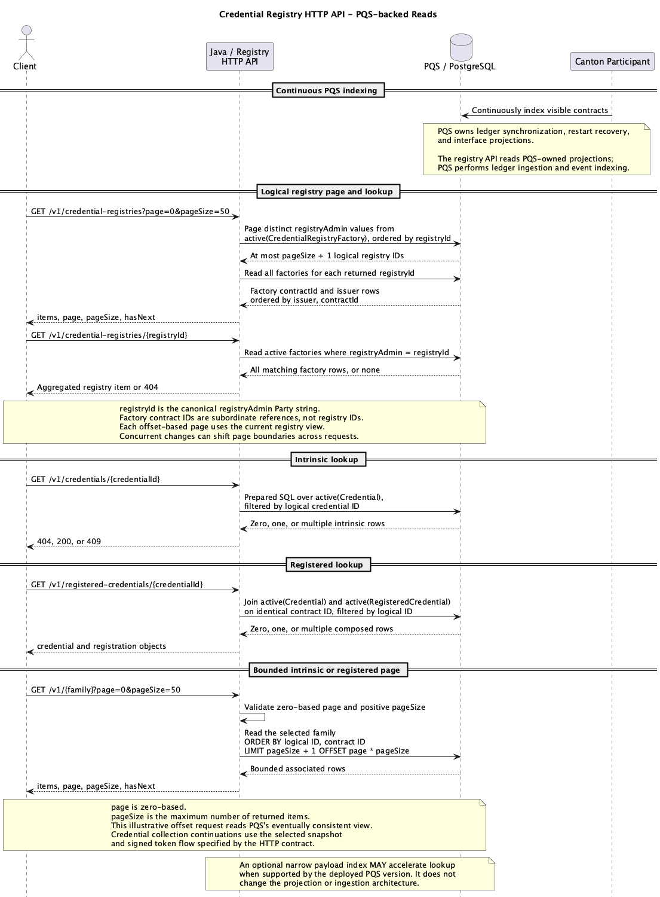
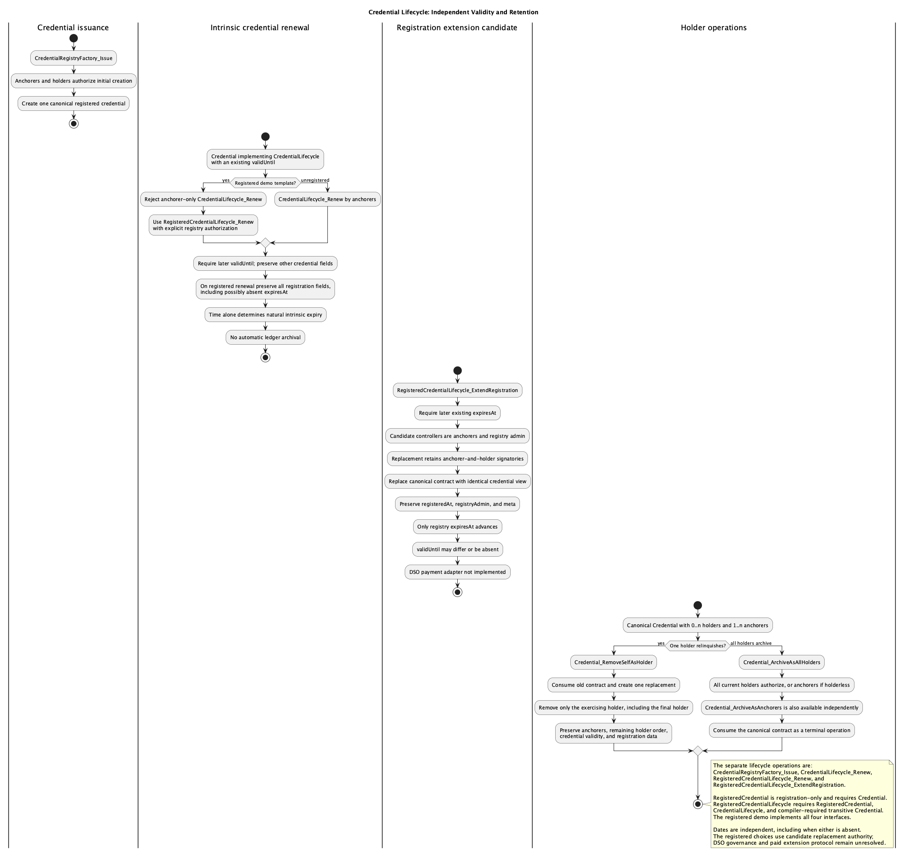

<pre>
  CIP: CIP TBD
  Layer: Daml
  Title: Canton Network Credentials Standard
  Author:
    Luís Marado (inspired by Simon Meier's CIP Draft #204)
  License: CC0-1.0
  Status: Early Draft (comment threads at the bottom of this doc, and inlined TODO notes)
  Type: Standards Track
  Created: 2026-01-09
</pre>

# Canton Network Credentials Standard

## Abstract

Define a portable base credential contract standard and a credential registry interface and API standard built on that base, and explore a DSO-governed shared-registry deployment profile for storing, retrieving, and using registered credentials, including DID-based registry identity and endpoint discovery.

## Specification

This CIP defines one core credential standard with two distinct surfaces:

* the **Base Credential Contract Standard**, for intrinsic credentials that can exist and be used without a registry; and
* the **Credential Registry Interface and API Standard**, a registry capability built on the base interface, with registry-specific metadata and lifecycle operations plus access-policy-neutral read-only HTTP APIs for exposed credential records. A conforming registry keeps its backend and APIs within the same responsibility boundary so consumers do not depend on its storage implementation.

The standard supports three deployment modes:

* **direct-issued Credential without a registry:** an issuer-specific workflow creates a contract implementing the base `Credential` interface without requiring a registry or registry HTTP API;
* **issuer-operated registry:** the issuer, or infrastructure it controls, adds the registry capability and APIs; and
* **third-party or shared registry:** a separate administrator registers credentials for issuers and holders under its own registry policy.

### Architecture Overview (Non-Normative)

The system context centers on the Canton Network Credentials Standard as the C4 system of interest. Direct issuance applications, registry-facing issuance applications, wallets, and explorers use the credential and registry interfaces defined by the standard. Registry-facing applications may resolve a registry DID through a deployed Canton Network DID Registry or Resolver to discover endpoint candidates before invoking the Credential Registry API.

Credential issuance remains the responsibility of issuer-specific software. Credential Issuers use direct or registry-facing issuance applications. Credential Holders receive and use direct credentials without required registry publication. App Users use app or wallet providers and network explorers as separate applications: wallets may support holder workflows, while explorers consume credential records and history exposed to them by a deployment. Using an explorer does not imply ledger Party authority. Issuers and holders may also use these applications. Entities may act in multiple roles. For example, a bank can issue credentials to its customers while also holding credentials issued to it by regulators.

The DSO deployment profile has one logical DSO Credential Registry. The DSO Party, collectively controlled by all SVs, administers and operates it through the registry-facing issuance application. The standard remains a conceptual specification boundary rather than a deployed service.


*System Context for the Canton Network Credentials Standard and its external actors. [C4-PlantUML source](images/credentials-system-context.puml).*

The System Context is a simplification that separates direct issuance from registry-facing issuance for clarity; these labels describe roles, not required deployment boundaries or ledger access classifications. One issuance application or registry-facing deployment may implement either capability or both. Each deployment defines whether and how credential records are exposed, including filtering, authentication, authorization, and audience.

The System Context elements below identify the people and external systems shown in the diagram.

| Element | Type | Diagram role or boundary |
| --- | --- | --- |
| Credential Issuer | Person | Organization or individual acting in the issuer role. |
| Credential Holder | Person | Party acting in the holder role. |
| App User | Person | User of credential applications, wallets, and network explorers; using an explorer does not imply ledger Party authority. |
| Canton Network Credentials Standard | System of interest | Conceptual specification boundary for portable credentials, registration, registry HTTP access, lifecycle rules, and credential and registry API contracts. |
| Direct Credential Issuance Application | External system | Issuer-specific software for issuance and holder workflows without required registry publication. |
| Registry-facing Credential Issuance Application | External system | Issuer-specific software that adds registration or HTTP exposure and may resolve a known registry DID to obtain endpoint candidates before invoking the Credential Registry API defined within the Canton Network Credentials Standard. |
| App / Wallet Provider | External system | Application or wallet that handles credentials for issuers, holders, and app users using APIs defined by the standard. |
| Network Explorer | External system | Explorer that uses APIs defined by the standard to consume credential records and lifecycle information exposed under deployment policy. |
| Canton Network DID Registry / Resolver | External system | Deployed registry or resolver that resolves a known registry DID and returns endpoint candidates. |
| DSO Party / SV Governance | Person | The DSO Party, collectively controlled by all SVs, acting as administrator and operator of the one logical DSO Credential Registry through the registry-facing application. |

DID discovery identifies or resolves endpoint candidates only. It does not establish registry authorization, endpoint trust, caller authentication, quorum or failover behavior, or governance approval. Those controls remain separate deployment responsibilities.

#### Credential Registry Reference Application (DSO-managed)

This CIP also describes a DSO-managed Credential Registry reference application that demonstrates the core standard through one logical Credential Registry. Credential issuance remains an issuer-application responsibility and may be direct or registry-facing. The reference application demonstrates registration, registry access, and the DSO deployment profile; it does not define a generic application or metadata-discovery layer. The later DSO Credential Registry Deployment Profile defines its concrete deployment as one logical Credential Registry, administered and operated by a single DSO Party under the collective control of all SVs. The profile adds DSO-specific governance, registration expiry, fee considerations, and an exploratory composition with the Canton Network DID standard for registry identity and endpoint discovery. Implementations may expose the registry through multiple endpoints while preserving the same registry identity and governance model.

This is the initial DSO deployment profile. Future iterations may define additional deployment models, including delegated operation or partitioning.

### Credential Contract and Registry Standard

The core standard defines Daml interfaces for the base `Credential`, `RegisteredCredential`, and `CredentialRegistryFactory`, and HTTP interfaces for credential registry listing, lookup, and bulk retrieval. Credential Lifecycle relates intrinsic validity, registration lifecycle, and archival or removal behavior. A base credential can exist without registration.

#### Daml Interfaces

The four candidate credential Daml interfaces are `Credential`, `CredentialLifecycle`, `RegisteredCredential`, and `RegisteredCredentialLifecycle`; `CredentialRegistryFactory` provides the separate generic issuance capability. Candidate public `CredentialRequest` and `CredentialOffer` interfaces provide an optional asynchronous issuance path. Their candidate definitions are checked in at [`demo/interface/daml/Canton/Network/Credentials/V1.daml`](demo/interface/daml/Canton/Network/Credentials/V1.daml), with candidate status and build instructions in [`demo/interface/README.md`](demo/interface/README.md); concrete templates and package naming for standardization remain outside that source; implementing templates MUST enforce the signatory rules below.

##### Credential Interface

A base credential represents issuer assertions about one or more credential subjects. The fields oriented toward the [W3C Verifiable Credentials Data Model 2.0](https://www.w3.org/TR/vc-data-model-2.0/) form the basis of `CredentialView`:

- credential identifier;
- credential types;
- issuer;
- credential subjects;
- validity interval;
- optional `credentialSchema` references; and
- optional stored securing material in the Daml view.

Holders and anchorers are separate Canton operational metadata. Holders MAY be empty; anchorers MUST be nonempty. Entries within `holders` and within `anchorers` MUST be unique; implementations MUST reject duplicates rather than silently normalize them. Both remain lists: lists have better JSON encoding than Daml Sets, and `NonEmpty` is available for the mandatory anchorers but has no Set equivalent. Concrete credential signatories MUST be the concatenation of anchorers followed by holders; a Party MAY occur in both roles. Issuer, subject, holder, anchorer and registry administrator roles are otherwise independent. An external textual issuer need not be a Party; anchoring proves neither its signature nor the truth of its claims.

A `W3C_VC_Identifier_Party` issuer MUST be among `anchorers`, and is therefore a signatory of the concrete credential. Concrete templates MUST enforce this invariant in their creation precondition, not only inside a factory choice, so no contract can name a Canton Party as issuer without that Party's own Daml authorization, including when the credential is created outside `CredentialRegistryFactory_Issue`. A `W3C_VC_Identifier Text` issuer carries no ledger-level authorization at all: its authenticity must be established off-ledger by the consuming application, never by the anchorers' signatures. The demo requires stored securing material for a textual issuer at both `_Anchor` and concrete-template creation; the ledger checks its structure, not its issuer signature.

Field position and explicit Daml authority keep identity and operational roles independent:

- issuer identity identifies the entity making assertions and does not imply holder status or Canton authorization;
- credential subjects identify who or what claims concern when an ID is present; a Party subject does not become a holder, controller, or authorized actor;
- Canton operational holders are explicitly listed Parties; holder status does not imply subject or issuer identity;
- controllers and authorization come from explicit interface choices and template authority, not generic payload inference.

In practice, clients use the typed fields according to their declared roles, and templates authorize operations explicitly. Implementations MUST NOT scan credential identifiers, claims, nested `AnyValue`, or other payload content to infer subjects, holders, controllers, or authorization.

**Table 1. Core `CredentialView` fields**

  | CredentialView field | W3C VC Data Model 2.0 concept | External serialization | Canton semantics |
  | --- | --- | --- | --- |
  | `CredentialView.id : Optional Text` | Credential [`id`](https://www.w3.org/TR/vc-data-model-2.0/#identifiers) | Profile-defined URL when present | Semantic correspondence; the Daml value requires profile mapping. |
  | `CredentialView.credentialTypes : [Text]` | W3C [`type`](https://www.w3.org/TR/vc-data-model-2.0/#types) | Serialize as JSON-LD `type` values | A W3C-exportable representation MUST include `VerifiableCredential` among the values. |
  | `CredentialView.issuer : W3C_VC_Identifier` | [`issuer`](https://www.w3.org/TR/vc-data-model-2.0/#issuer) | Identifier selected by the ADT variant | Issuer identity retains its field-specific role. |
  | `CredentialView.validFrom : Optional Time`; `CredentialView.validUntil : Optional Time` | [`validFrom`, `validUntil`](https://www.w3.org/TR/vc-data-model-2.0/#validity-period) | Profile-defined date-time representation | Start of validity and optional intrinsic end of validity. Natural expiry after `validUntil` is derived from time, independently of ledger transactions. |
  | `CredentialView.credentialSubject : NonEmpty CredentialSubject` | [`credentialSubject`](https://www.w3.org/TR/vc-data-model-2.0/#credential-subject) | One subject object or an array, as the profile permits | The interface enforces `1..n` subjects. |
  | `CredentialView.credentialSchema : [CredentialSchema]` | [`credentialSchema`](https://www.w3.org/TR/vc-data-model-2.0/#data-schemas) | When present, one or more entries with URL `id` and `type`; optional `digestSRI` in the selected schema profile | Empty list means absent; the demo checks nonempty `id` and `schemaType` only, not URL syntax, schema integrity or evaluation. |
  | `CredentialView.securing : Optional CredentialSecuring` | [Securing mechanisms](https://www.w3.org/TR/vc-data-model-2.0/#securing-mechanisms) | One stored selected enveloped or embedded secured representation in the demo profile | Textual issuers require `Some`; Party issuers may use `None`, which is not by itself a W3C-secured VC. Structural checks do not verify proofs. |
  | `CredentialView.holders : [Party]` | Canton extension with no core-VC counterpart | Profile extension when defined | Unique list of zero or more operational holder Parties. |
  | `CredentialView.anchorers : NonEmpty Party` | Canton extension with no core-VC counterpart | Profile extension when defined | Nonempty unique list of anchoring Parties, retained even when holders are empty; not proof of external issuer claims or signature. |

Semantic correspondence alone does not make `CredentialView` a conforming compacted JSON-LD VC. External conformance additionally requires the mandated [`@context`](https://www.w3.org/TR/vc-data-model-2.0/#contexts), W3C-compatible [`identifiers`](https://www.w3.org/TR/vc-data-model-2.0/#identifiers), and at least one [`securing mechanism`](https://www.w3.org/TR/vc-data-model-2.0/#securing-mechanisms). W3C permits embedded and enveloping mechanisms to coexist; the demo stores only one selected secured representation. A Party issuer's Daml authorization is not a W3C securing mechanism. `CredentialView.credentialTypes` supplies the W3C `type` values. See Credential Interface Normalization for detailed serialization rules.

`holders` and `anchorers` are Canton operational metadata and MUST be excluded from standard W3C serialization unless a named extension profile defines their fields, context, semantics, and security considerations. The interface view does not itself grant Daml visibility. Concrete templates MUST make holders and anchorers signatories as specified above; they see the full canonical credential and complete role lists. Templates may additionally define observers.

The `credentialSubject` field expands into one or more subject records whose optional identifiers and claims have the following fields.

**Table 2. `CredentialSubject` fields**

  | CredentialSubject field | W3C VC Data Model 2.0 concept | External serialization | Profile semantics |
  | --- | --- | --- | --- |
  | `CredentialSubject.id : Optional W3C_VC_Identifier` | Optional credential subject [`id`](https://www.w3.org/TR/vc-data-model-2.0/#identifiers) | `Some identifier` emits `credentialSubject.id`; `None` omits it | Claims remain valid when the ID is absent. |
  | `CredentialSubject.claims : TextMap Api.Token.MetadataV1.AnyValue` | Properties of the [`credentialSubject`](https://www.w3.org/TR/vc-data-model-2.0/#credential-subject) | Direct properties of the same `credentialSubject` object | Namespaced property semantics and JSON-LD mapping are profile-defined. |

The issuer and each present subject ID use the same `W3C_VC_Identifier` sum type. Field position determines whether a value represents the issuer or a subject. The issuer maps by field position to W3C `issuer`; a present subject ID maps to `credentialSubject.id`. Party identifiers require a profile-defined URL or DID mapping. Text identifiers MUST be permitted and validated by the profile.

**Table 3. `W3C_VC_Identifier` variants**

  | Identifier type / constructor | Used by | Value carried | Serialization and validation |
  | --- | --- | --- | --- |
  | `W3C_VC_Identifier_Party Party` | `CredentialView.issuer`; present `CredentialSubject.id` | Canton-native `Party` | Requires a profile-defined Party-to-URL-or-DID mapping. Field position determines whether the external value maps to W3C `issuer` or `credentialSubject.id`. |
  | `W3C_VC_Identifier Text` | `CredentialView.issuer`; present `CredentialSubject.id` | Profile-permitted external identifier text | Requires profile validation before serialization. Field position determines whether the external value maps to W3C `issuer` or `credentialSubject.id`. |

Each entry in `CredentialSubject.claims` uses `Api.Token.MetadataV1.AnyValue`, including recursive collections and values that require profile-defined external identifiers. Claims are the subject-property carrier and flatten to direct properties without a `claims` wrapper. The claim key `id` remains reserved even when the subject ID is absent, so claims cannot manufacture or shadow `credentialSubject.id`.

**Table 4. `AnyValue` claim-value types**

  | Supporting type or constructor | Claim-value role | External representation | Serialization requirements |
  | --- | --- | --- | --- |
  | `Api.Token.MetadataV1.AnyValue` (`AV_Text`, `AV_Int`, `AV_Decimal`, `AV_Bool`, `AV_Date`, `AV_Time`, `AV_RelTime`, `AV_Party`, `AV_ContractId`, `AV_List`, `AV_Map`) | Subject-property value carrier | Profile's target representation | Canton-native typed values, not a complete JSON-LD value model. |
  | `AV_List`, `AV_Map` | Recursive collection values | Profile-defined array, set, or map representation | Nested values are mapped recursively. |
  | `AV_Party`, `AV_ContractId` | Values requiring profile-defined external identifiers | Profile-defined external identifiers | Native values require explicit interoperable mappings. |

This standard requires a stable, general-purpose `AnyValue` type for credential metadata. The candidate implementation currently reuses `splice-api-token-metadata-v1.AnyValue`.

`CredentialSchema` carries `id : Text`, `schemaType : Text` (the JSON `type`), and `digestSRI : Optional Text`. A W3C `credentialSchema`, if present, identifies one or more schemas, each with a URL `id` and `type`. The [VC JSON Schema](https://www.w3.org/TR/vc-json-schema/) vocabulary includes `JsonSchema` and `JsonSchemaCredential`; integrity requirements depend on the selected type and profile. `digestSRI` is not universally mandatory. Off-ledger schema evaluation distinguishes Success, Failure, and Indeterminate; no on-ledger schema evaluation occurs.

`CredentialSecuring` stores either `EnvelopedProof {mediaType, encoded}` for a selected [VC-JOSE-COSE](https://www.w3.org/TR/vc-jose-cose/) representation (`application/vc+jwt`, `application/vc+sd-jwt`, or `application/vc+cose`) or `EmbeddedProof {securedDocument, proofs : NonEmpty DataIntegrityProofSummary}` for a selected [Data Integrity](https://www.w3.org/TR/vc-data-integrity/) representation. The original secured JSON including its `proof` is preserved in `securedDocument`; `encoded` preserves the enveloped representation. Proof summaries are derived indexes, not substitutes for signed bytes. W3C [EnvelopedVerifiableCredential](https://www.w3.org/TR/vc-data-model-2.0/#enveloped-verifiable-credentials) is a presentation reference to a secured envelope, not an instruction to reinterpret or reconstruct its signed payload. The Daml checks only nonempty material, supported media-type labels and minimal proof summary fields. It does not establish cryptographic validity, schema validity, issuer-controller binding, or time-of-use validity. Typed view fields are derived indexes of the secured document; a mismatch means the record is not verified. Off-ledger consumers must check these properties under their trust policy. The demo API implements a deliberately narrow offline verifier for `did:key` Ed25519 keys with EdDSA `application/vc+jwt` and Data Integrity `eddsa-jcs-2022`, not a general VC verifier.

```daml
import DA.NonEmpty (NonEmpty, toList)
import DA.TextMap (TextMap)
import Splice.Api.Token.MetadataV1 qualified as Api.Token.MetadataV1

data W3C_VC_Identifier
  = W3C_VC_Identifier_Party Party
  | W3C_VC_Identifier Text
  deriving (Eq, Ord, Show)

data CredentialSubject = CredentialSubject with
  id : Optional W3C_VC_Identifier
  claims : TextMap Api.Token.MetadataV1.AnyValue
  deriving (Eq, Show)

data CredentialSchema = CredentialSchema with
  id : Text
  schemaType : Text
  digestSRI : Optional Text
  deriving (Eq, Show)

data DataIntegrityProofSummary = DataIntegrityProofSummary with
  proofId : Optional Text
  proofType : Text
  cryptosuite : Optional Text
  created : Optional Text
  expires : Optional Text
  verificationMethod : Optional Text
  proofPurpose : Text
  previousProof : [Text]
  deriving (Eq, Show)

data CredentialSecuring
  = EnvelopedProof with
      mediaType : Text
      encoded : Text
  | EmbeddedProof with
      securedDocument : Text
      proofs : NonEmpty DataIntegrityProofSummary
  deriving (Eq, Show)

data CredentialView = CredentialView with
  id : Optional Text
  credentialTypes : [Text]
  issuer : W3C_VC_Identifier
  validFrom : Optional Time
  validUntil : Optional Time
  credentialSubject : NonEmpty CredentialSubject
  credentialSchema : [CredentialSchema]
  securing : Optional CredentialSecuring
  holders : [Party]
  anchorers : NonEmpty Party
  deriving (Eq, Show)

data Credential_RemoveSelfAsHolderResult = Credential_RemoveSelfAsHolderResult with
  replacementCredential : ContractId Credential
  deriving (Eq, Show)

data Credential_ArchiveResult = Credential_ArchiveResult with
  archivedCredential : CredentialView
  meta : Api.Token.MetadataV1.Metadata
  deriving (Eq, Show)

interface Credential where
  viewtype CredentialView

  credential_publicFetchImpl : ContractId Credential -> Credential_PublicFetch -> Update CredentialView

  nonconsuming choice Credential_PublicFetch : CredentialView
    with
      actor : Party
    controller actor
    do
      credential_publicFetchImpl this self arg

  credential_removeSelfAsHolderImpl : ContractId Credential -> Credential_RemoveSelfAsHolder -> Update Credential_RemoveSelfAsHolderResult

  choice Credential_RemoveSelfAsHolder : Credential_RemoveSelfAsHolderResult
    with
      holder : Party
    controller holder
    do
      let currentHolders = (view this).holders
      assertMsg "exercising party is not a credential holder" (elem holder currentHolders)
      credential_removeSelfAsHolderImpl this self arg

  credential_archiveAsAllHoldersImpl : ContractId Credential -> Credential_ArchiveAsAllHolders -> Update Credential_ArchiveResult

  choice Credential_ArchiveAsAllHolders : Credential_ArchiveResult
    controller (if null (view this).holders then toList (view this).anchorers else (view this).holders)
    do
      credential_archiveAsAllHoldersImpl this self arg

  choice Credential_ArchiveAsAnchorers : Credential_ArchiveResult
    controller (toList (view this).anchorers)
    do
      credential_archiveAsAllHoldersImpl this self Credential_ArchiveAsAllHolders
```

`Credential_RemoveSelfAsHolder` is a consuming choice controlled exactly by its `holder` argument. The interface verifies that the controller is a current holder and permits removal of the final holder, then delegates concrete replacement construction to the abstract implementation method. The implementation MUST consume the old canonical credential, create exactly one replacement without that holder, preserve the remaining holder order, and return its `ContractId Credential` in `Credential_RemoveSelfAsHolderResult`. It MUST preserve logical credential identity, credential types, issuer, subjects and claims, intrinsic validity, and unrelated profile fields. A holder can remove only itself, never another holder.

The generic interface standardizes the choice, argument, controller, preconditions, consuming replacement semantics, and result. The implementing template or profile constructs the concrete replacement and MUST satisfy its signatory, observer, and authorization rules. A holder-controlled interface exercise does not authorize creation under arbitrary template signatories. The required signatories are the concatenation of anchorers followed by holders; the concrete demo enforces this directly. Replacement preserves anchorers even when no holders remain.

`Credential_PublicFetch` is nonconsuming and controlled exactly by its `actor` argument. It returns the current `CredentialView` inside the exercising transaction, so a non-stakeholder application that received the contract through explicit disclosure can confirm the credential at transaction time instead of trusting an indexed row or a stored disclosure blob. Being able to read a disclosed contract is not authority over it; the choice grants no mutation.

`Credential_ArchiveAsAllHolders` is terminal and controlled jointly by every holder, or by the nonempty anchorer list when holderless. `Credential_ArchiveAsAnchorers` independently allows the anchorers to archive any credential. Both terminate the canonical contract; the controller set is always nonempty. The base interface does not define issuer-authorized archival or revocation because `W3C_VC_Identifier Text` cannot control a Daml choice. A profile or template that needs either operation MUST define an explicit Party authorization mechanism and choice, and MUST NOT infer that Party from holders, subjects, claims, or external text. Wallets MAY remove their local reference or presentation without changing the ledger contract. They MUST distinguish that local action from holder relinquishment, global archival, issuer revocation, expiration, registry removal, and deregistration.

**Base `Credential` choices**

| Choice | Controller | Preconditions | Consuming outcome |
| --- | --- | --- | --- |
| `Credential_PublicFetch` | Exactly `actor` | `actor` can reach the contract, in practice through explicit disclosure | Nonconsuming; returns the current `CredentialView` at transaction time. |
| `Credential_RemoveSelfAsHolder` | Exactly `holder` | `holder` is current; final-holder removal is permitted | Replaces the canonical contract once, preserving credential state and remaining holder order; returns `replacementCredential : ContractId Credential`. |
| `Credential_ArchiveAsAllHolders` | Every current holder jointly, or anchorers when holderless | The nonempty controller set authorizes | Terminates the current canonical contract; this is a terminal operation. |
| `Credential_ArchiveAsAnchorers` | All anchorers jointly | Anchorers authorize regardless of holder count | Terminates the current canonical contract; this is a terminal operation. |

###### Credential Interface Normalization

One logical VC uses one canonical `Credential` contract. Every credential MUST have at least one anchorer and MAY have no holders. Current holders and anchorers share its contract ID, full payload, and intrinsic validity. Signatories MUST be the concatenation of anchorers followed by holders; role-list order is retained. Concrete templates MUST reject duplicate entries within either list. The view is not mutated in place: holder self-removal consumes the canonical contract and creates one replacement through the standardized choice. The replacement MUST remove exactly the exercising holder and preserve the order of all remaining holders. Frequent independently mutable or holder-private relationships MAY require future separate holder-association contracts, but this CIP does not define them. Optional association contracts MUST NOT imply a relationship between a credential subject and a Party.

- Concrete templates MUST reject the reserved key `id` in `claims`, including when the subject ID is `None`.
- Concrete templates MUST reject a credential whose issuer is a `W3C_VC_Identifier_Party` absent from `anchorers`. The demo template also rejects a textual issuer without securing, including direct creation outside the factory.
- An absent `credentialSchema` is an empty list; a present external `credentialSchema` MUST have one or more entries with URL `id` and `type`. The demo's Daml check of nonempty strings is not URL or schema validation.
- Secured bytes MUST be retained without rebuilding a signature input from typed fields. Consumers MUST compare typed indexes against the verified secured document and reject mismatches as unverified.
- W3C serializers MUST map the Daml field `credentialTypes` to JSON-LD `type`; ledger and PQS payloads retain `credentialTypes`.
- Serializers MUST emit a present subject identifier as `credentialSubject.id` and omit that property for `None`.
- Serializers MUST flatten `CredentialSubject.claims` into direct subject properties without a `claims` wrapper.
- A subject with no ID MAY still carry claims.
- Multi-valued claims MUST use `AV_List`.
- Serializers MUST recursively map `AV_List` and `AV_Map`.
- Serializers MUST map every `AV_Party` and `AV_ContractId` according to the declared external profile. The `/v1` read profile emits their original Party and ContractId values as ordinary JSON strings, without inventing DIDs.
- Concrete templates MUST validate every present `W3C_VC_Identifier` according to the applicable profile and MUST apply profile-defined claim constraints.
- Implementations MUST NOT infer a missing subject ID from claims, holders, the issuer, or nested values.
- Identifier lookup MUST match only present IDs; subjects with absent IDs MUST NOT match identifier filters.

This draft defines no canonical JSON-LD normalization. The `/v1` read profile always emits a subject array, even for one subject. Deterministic ordering currently applies to holder Parties, not arbitrary claim keys or properties. For example, a claims-only subject can use `CredentialSubject { id = None, claims = TextMap.fromList [("profile.example/status", Api.Token.MetadataV1.AV_Text "active")] }`.

##### Registered Credential Interface

`RegisteredCredential` requires `Credential` and exposes the registry state associated with the same canonical contract. Clients project its view independently from `CredentialView`.

The registration view carries the administering Party, registration time, optional retention expiry, and extensibility metadata.

**Table 5. `RegisteredCredentialView` fields**

| Field | Type | Meaning |
| --- | --- | --- |
| `registryAdmin` | `Party` | Party administering this registration. |
| `registeredAt` | `Time` | Time at which the credential was registered. |
| `expiresAt` | `Optional Time` | Optional registry-retention expiry, independent of `CredentialView.validUntil`; see Credential Lifecycle. |
| `meta` | `TextMap Api.Token.MetadataV1.AnyValue` | Registry-specific extensibility metadata. |

`RegisteredCredential` is registration-only and requires `Credential`; registration does not make lifecycle support mandatory. Its interface offers the read operation below. The operation returns one result record carrying both views, because a consumer confirming a registered credential needs the credential content and its registration in the same transaction; two separate fetches could observe different contracts.

**Table 6. `RegisteredCredential` choices**

| Choice | Input | Controller | Result | Behavior |
| --- | --- | --- | --- | --- |
| `RegisteredCredential_PublicFetch` | `expectedRegistryAdmin : Party`; `actor : Party` | `actor` | `RegisteredCredential_PublicFetchResult` | Nonconsuming fetch returning both the `CredentialView` and the `RegisteredCredentialView`, requiring the returned `registryAdmin` to equal `expectedRegistryAdmin`. |

`RegisteredCredentialLifecycle` offers separate intrinsic renewal of a registered credential and registry-only registration extension. It requires `RegisteredCredential`, `CredentialLifecycle`, and `Credential`; the final `Credential` is conceptually implied by both parent interfaces but is declared because Daml requires the full transitive interface requirement closure. The candidate `ExtendRegistration` choice is separate from `Renew`, which now advances only intrinsic validity; the old combined behavior is not retained. Adding an interface method changes the package ID, so the demo increments the interface DAR from 0.1.0 to 0.2.0. Consumers must rebuild and vet the changed DAR; the `V1` module name is not a binary-compatibility promise.

**Table 7. `RegisteredCredentialLifecycle` choices**

| Choice | Input | Controller | Result | Behavior |
| --- | --- | --- | --- | --- |
| `RegisteredCredentialLifecycle_Renew` | Exact current credential view, `registryAdmin`, later `validUntil`, `newSecuring`; legacy optional profile authorization and payment-evidence fields are not evaluated | Candidate: anchorers followed by registry admin; final policy unresolved | `RegisteredCredentialLifecycle_RenewResult` | Consumes and replaces the registered contract, changing intrinsic `validUntil` and replacing or clearing securing. Registration, including `expiresAt`, remains unchanged; registry authority is required to preserve its continuity. No payment processing is implemented. |
| `RegisteredCredentialLifecycle_ExtendRegistration` | Exact current credential view, `registryAdmin`, later `expiresAt` | Candidate: anchorers followed by registry admin; final policy unresolved | `RegisteredCredentialLifecycle_ExtendRegistrationResult` | Consumes and replaces the registered contract, retaining the entire credential view and all registration fields except `expiresAt`. A future DSO payment adapter is separate and unimplemented. |

Intrinsic credential lifecycle is registry-independent. Registration is optional, and intrinsic issuance, renewal, expiry, or archival neither requires nor implies registration, registration continuation, or a registry mutation. Conversely, registration retention does not extend, revive, or otherwise alter the credential. A concrete contract implementing both interfaces cannot silently carry forward registration through anchorer-only intrinsic renewal. The reference demo rejects `CredentialLifecycle_Renew` on its registered template; `RegisteredCredentialLifecycle_Renew` changes intrinsic validity and updates or clears securing while explicitly requiring registry authorization to preserve registration. Implementations may expose the lifecycles separately, coordinate them atomically when a profile defines the required authority, or orchestrate them as multiple steps with explicit partial-failure handling. An optional capability MUST NOT mandate any deployment topology.

Any operation that creates, extends, removes, or otherwise changes or continues registration MUST have registry authorization. The candidate demo uses current anchorers plus `registryAdmin` as controllers for each consuming replacement and retains the anchorer-and-holder signatories. Daml tests show that an admin-only consuming choice can create that signed successor through its authorized choice body: the ledger's create node carries the signatories, even though only the admin submitted. Observer status alone is not choice authority; the choice explicitly names the admin as controller. The demo's joint-controller requirement is a conservative candidate for authorizing registration continuity, not a Daml necessity or final DSO policy. Renewal and extension authority remain unresolved, and a payer MAY be a different party. Payment is an unimplemented condition of a future DSO extension profile, not generic authority over either lifecycle.

The interface below is candidate material rather than a completed generic lifecycle contract. Before standardization, the controllers, policy hooks, payment binding, and failure semantics MUST be reviewed for the selected profile. Callers MUST obtain `registryAdmin` from a trusted source, and implementations MUST validate it against the view and verify the entire expected credential against the current contract. Package vetting and registry-provider security review remain necessary.

```daml
-- Candidate; sourced from demo/interface/daml/Canton/Network/Credentials/V1.daml.
data RegisteredCredentialView = RegisteredCredentialView with
  registryAdmin : Party
  registeredAt : Time
  expiresAt : Optional Time
  meta : TextMap Api.Token.MetadataV1.AnyValue
  deriving (Eq, Show)

data RegisteredCredential_PublicFetchResult = RegisteredCredential_PublicFetchResult with
  credential : CredentialView
  registration : RegisteredCredentialView
  deriving (Eq, Show)

interface RegisteredCredential requires Credential where
  viewtype RegisteredCredentialView

  registeredCredential_publicFetchImpl : ContractId RegisteredCredential -> RegisteredCredential_PublicFetch -> Update RegisteredCredential_PublicFetchResult

  nonconsuming choice RegisteredCredential_PublicFetch : RegisteredCredential_PublicFetchResult
    with
      expectedRegistryAdmin : Party
      actor : Party
    controller actor
    do
      result <- registeredCredential_publicFetchImpl this self arg
      assertMsg "unexpected registry administrator" (expectedRegistryAdmin == result.registration.registryAdmin)
      pure result

data RegisteredCredentialLifecycle_RenewResult = RegisteredCredentialLifecycle_RenewResult with
  replacementCredential : ContractId RegisteredCredentialLifecycle
  deriving (Eq, Show)

data RegisteredCredentialLifecycle_ExtendRegistrationResult = RegisteredCredentialLifecycle_ExtendRegistrationResult with
  replacementCredential : ContractId RegisteredCredentialLifecycle
  deriving (Eq, Show)

interface RegisteredCredentialLifecycle requires RegisteredCredential, CredentialLifecycle, Credential where
  viewtype RegisteredCredentialView

  registeredCredentialLifecycle_renewImpl : ContractId RegisteredCredentialLifecycle -> RegisteredCredentialLifecycle_Renew -> Update RegisteredCredentialLifecycle_RenewResult

  choice RegisteredCredentialLifecycle_Renew : RegisteredCredentialLifecycle_RenewResult
    with
      expectedCredential : CredentialView
      registryAdmin : Party
      validUntil : Time
      newSecuring : Optional CredentialSecuring
      profileAuthorization : Optional (TextMap Api.Token.MetadataV1.AnyValue)
      paymentEvidence : Optional (TextMap Api.Token.MetadataV1.AnyValue)
    controller (toList expectedCredential.anchorers <> [registryAdmin])
    do
      assertMsg "renewal requires an existing validUntil" (expectedCredential.validUntil /= None)
      assertMsg "renewal validUntil must be strictly later" (Some validUntil > expectedCredential.validUntil)
      assertMsg "renewal requires securing that covers the new validity" (renewalSecuringValid expectedCredential newSecuring)
      assertMsg "party is not the registry administrator" (registryAdmin == (view this).registryAdmin)
      registeredCredentialLifecycle_renewImpl this self arg

  registeredCredentialLifecycle_extendRegistrationImpl : ContractId RegisteredCredentialLifecycle -> RegisteredCredentialLifecycle_ExtendRegistration -> Update RegisteredCredentialLifecycle_ExtendRegistrationResult

  choice RegisteredCredentialLifecycle_ExtendRegistration : RegisteredCredentialLifecycle_ExtendRegistrationResult
    with
      expectedCredential : CredentialView
      registryAdmin : Party
      expiresAt : Time
    controller (toList expectedCredential.anchorers <> [registryAdmin])
    do
      assertMsg "party is not the registry administrator" (registryAdmin == (view this).registryAdmin)
      assertMsg "extension requires an existing expiresAt" ((view this).expiresAt /= None)
      assertMsg "extension expiresAt must be strictly later" (Some expiresAt > (view this).expiresAt)
      registeredCredentialLifecycle_extendRegistrationImpl this self arg
```

`CredentialView.validUntil` remains intrinsic validity and `RegisteredCredentialView.expiresAt` remains registry retention, including in the DSO profile. Neither is required to exist when the other does, and they need not be equal or advance together. A concrete registered credential MAY also implement `CredentialLifecycle`; that capability is not required by `RegisteredCredential`, and any consuming intrinsic renewal on a registered template MUST NOT silently continue registration without registry authorization.

When an implementation is also a `RegisteredCredential`, `Credential_RemoveSelfAsHolder` MUST preserve registration continuity. The four registration fields MUST be copied unchanged, and contract-ID references MUST be updated atomically in the same transaction. The generic result remains `ContractId Credential`; an implementation MUST NOT add a second registered self-removal choice that conflicts with or bypasses the base choice.

##### Credential Registry Factory Interface

`CredentialRegistryFactory` provides two generic entry points for creating a registered credential: Party-authorized issuance and anchoring of a credential with an external textual issuer. Its view identifies the registry administrator and the nonempty anchorer list authorized to anchor credentials through that factory.

**Table 7. `CredentialRegistryFactoryView` fields**

| Field | Type | Meaning |
| --- | --- | --- |
| `registryAdmin` | `Party` | Party administering registry registration. |
| `anchorers` | `NonEmpty Party` | Mandatory Parties authorizing anchoring through this factory. |

**Table 8. `CredentialRegistryFactory` choices**

| Choice | Controller | Inputs and preconditions | Result |
| --- | --- | --- | --- |
| `CredentialRegistryFactory_Issue` | Anchorers followed by holders and the issuer Party | The issuer MUST be `W3C_VC_Identifier_Party` and MUST be among the credential anchorers; the registration administrator MUST match the factory authority. The issuer Party and all proposed signatories authorize creation. | Creates one registered credential and returns its `ContractId RegisteredCredential`. |
| `CredentialRegistryFactory_Anchor` | Anchorers followed by holders | The issuer MUST be `W3C_VC_Identifier Text` and `securing` MUST be present; the registration administrator MUST match the factory authority. The proposed signatories authorize creation, without issuer authorization. | Creates one registered credential and returns its `ContractId RegisteredCredential`. |

Neither choice requires the credential anchorers to equal the factory anchorers. One factory supports credentials with arbitrary anchorers, because the anchorers already authorize each creation as signatories and the factory adds nothing to that authority. Which anchorers a registry is willing to register belongs to the deployment profile's acceptance policy, including the DSO profile, not to the generic interface.

Both choices are nonconsuming, so the factory remains available after either operation. They are separate because an external textual issuer cannot authorize a Daml choice. Anchoring attests on-ledger custody and publication by the anchorers only; it proves neither the external issuer's signature nor the truth of the claims. Within the factory, a Party issuer MUST use `CredentialRegistryFactory_Issue`; `CredentialRegistryFactory_Anchor` accepts textual issuers only, so it cannot be used to bypass a Party issuer's authorization. The generic factory defines no other lifecycle mutation. Reissue with changed claims, suspension, resumption, revocation, explicit early expiry, refresh, and deregistration are non-normative roadmap topics. The candidate `RegisteredCredentialLifecycle_ExtendRegistration` changes only registry retention on a registered concrete contract; general standalone retention updates beyond that candidate are not standardized. The local OpenAPI remains a read contract and does not standardize mutation endpoints for the Daml choices.

#### Credential Request and Offer (Candidate Public Interfaces)

The candidate `CredentialRequest` and `CredentialOffer` interfaces in [`V1.daml`](demo/interface/daml/Canton/Network/Credentials/V1.daml) define an optional asynchronous registration issuance path, implemented by `DemoCredentialRequest` and `DemoCredentialOffer` in the concrete [demo adapter](demo/model/daml/Canton/Network/Credentials/Demo.daml). The synchronous `CredentialRegistryFactory_Issue` and `_Anchor` remain unchanged with their existing joint controllers; direct factory Issue does not universally require separate administrator approval. Interfaces standardize views, controllers, consuming choices and implementation hooks, while implementing templates enforce stakeholder and payload invariants.

`CredentialRequestView` contains only `holder`, `requestedIssuer : Party`, `requestedType`, `registryAdmin` and nonempty `anchorers` for indispensable routing. It contains no claims, subject, validity, schema, proof, securing, or registration proposal. The demo holder signs the request; the targeted issuer, routed admin and anchorers observe it. The holder controls `CredentialRequest_Fulfill` and `CredentialRequest_Cancel`; the demo's offer acceptance invokes Fulfill, while the holder can also directly consume a pending request with either choice. The public interface does not expose eventual credential claims to a requester posting a request. The request is type-only as to credential content; `requestedIssuer` identifies its intended Party recipient, not a claim about the credential's contents.

`CredentialRequest_Approve` is a separate consuming issuer-only choice on the public request interface. It accepts the complete issuer-supplied `CredentialView`, `RegisteredCredentialView`, and factory ID; the issuer must be the `requestedIssuer` Party and the sole anchorer, the holder list must be exactly `[request.holder]`, the requested type must occur among `credentialTypes` (which may additionally include `VerifiableCredential`), and request anchorers and registry administrator must match the payload and factory. A distinct additional anchorer is deliberately rejected until a separately authorized protocol exists. The choice runs the real nonconsuming factory `_Issue`, consumes the request atomically and returns the registered credential; the holder is a signatory of the request and remains a signatory of the issued credential under inherited choice authority, without a second Accept. The issuer alone submits the approval and asserts all claims, subject, validity and securing fields: the holder's earlier type-only signature is advance consent to hold a credential from this issuer, **not endorsement of the unseen values**. A factory contract signed by its admin supplies factory authority, not per-payload admin co-signature or approval; the issuer must explicitly disclose that factory when it is not an ACS stakeholder. This does not establish a general registry acceptance policy, proof verification or authenticity for textual issuers. The existing synchronous `_Issue` and `_Anchor` are unchanged.

`CredentialOfferView` carries `request : Optional (ContractId CredentialRequest)` (`Some` for request-backed, `None` for unsolicited), the matching routing fields, `factory : ContractId CredentialRegistryFactory`, and complete issuer-supplied `CredentialView` and `RegisteredCredentialView`. Demo offer signatories are credential anchorers, any Canton Party issuer, and registry admin; its observer is the holder. The demo requires the requested type among credential types, the requester among operational holders, matching routed anchorers and registration administrator, and structurally valid credential fields. The admin's signature approves this particular offer, not every direct issuance. A textual issuer cannot sign on-ledger; securing material is structurally required but cryptographic verification remains off-ledger. Offer stakeholders see the full payload; the request alone never contains it. Holders are not factory observers.

The holder alone controls `CredentialOffer_Accept` and `CredentialOffer_Reject`; all offer anchorers jointly control `CredentialOffer_Withdraw`. Reject and Withdraw consume only that offer and leave any request available for other offers. When `request = Some id`, Accept checks the live request's routing view including the targeted Party issuer when applicable and consumes it through `CredentialRequest_Fulfill`; a stale or mismatched request fails. When `request = None`, an issuer can initiate an offer without a holder request, and Accept does not fetch or consume one. Both variants call the real factory `_Issue` for a Party issuer or `_Anchor` for a textual issuer with the complete immutable offer payload. The offer's anchorer and Party issuer signatures preauthorize their assertion, while the admin's signature authorizes publication of this particular offer, not the truth of its claims; the holder is only an observer before Accept and becomes a credential signatory through Accept authority. No credential is created before Accept. The holder must explicitly disclose the factory when not a stakeholder; Accept checks its admin against the offer and registration. Disclosure gives transaction reachability, not ongoing factory ACS visibility. A consuming Accept cannot be repeated, and the first accepted request-backed offer consumes the request so another offer for it cannot subsequently be accepted. `validUntil` remains credential validity and `expiresAt` independent registration retention. This candidate does not enforce global request uniqueness, offer expiry, cryptographic proof verification, or registry acceptance policy outside the signed offer. Direct factory choices remain available outside the offer protocol.

#### Registry-Scoped Name Allocation (Candidate Demo Profile)

Anyone may issue a credential asserting any name; a name claim confers no authorization. What makes a name credential *recognised* is that the registry issued or co-signed it, so the registry is the approval point. An applicant signs a `DemoNameRequest`; the pending request reserves nothing. The registry administrator may reject it, consuming the request and reserving nothing, or accept it through either `DemoNameRequest_AcceptAsRequesterIssued` or `DemoNameRequest_AcceptAsRegistryIssued`. Both choices consume the request and invoke `CredentialRegistryFactory_Issue` (never `Anchor`). In the requester-issued path the applicant, registry administrator, and any distinct credential holders jointly authorize acceptance, the applicant is the credential's Party issuer and asserts the binding, while the registry guarantees uniqueness, **not legitimacy**. Approval is first-come-first-served, like an unverified name namespace. In the registry-issued path the registry administrator and any distinct credential holders authorize acceptance; the registry administrator is the Party issuer and additionally attests that it verified the claimant. Each path rejects the other's issuer form. A consumer distinguishes these assertions by filtering the credential's `issuer`; `holders` is an independent list of operational Parties, and the name binds to the explicitly supplied Party subject ID. Resolution returns that subject ID, not an inferred holder identity. Identity verification is separate.

The registry is responsible for not approving the same name twice, and it discharges that responsibility **off-ledger**. No contract holds the namespace. The ledger enforces per-request structural validity only: canonical name form, the subject's `demo.example/name` claim matching the requested name, a present Party subject ID, registry anchoring with each holder authorizing the signed credential, the acceptance path matching the credential's issuer, and the registration belonging to the registry. It does not enforce global name uniqueness. Uniqueness is therefore **operational, not structural**: a registry fault, or concurrent approvals without off-ledger coordination, can produce two valid credentials for one name. The checked-in Daml test `ledgerDoesNotPreventDuplicateNames` demonstrates exactly that absence of a ledger-side guarantee. Consumers MUST handle the ambiguity; the demo resolution API answers `409` when a name resolves to more than one active credential. The guarantee was never network-global in any case: two registries can each approve the same name, so a resolved name is meaningful only relative to its issuing registry.

There is no on-ledger uniqueness index because LF 2.2 has no contract keys. Without keys, a choice body cannot test whether a name already exists unless some contract holds the namespace, and holding the namespace does not scale: every approval would read and rewrite that contract's full payload, which grows without bound against a transaction size limit. Sharding divides that growth but does not bound it. A key-based per-name record, as CIP #209 describes, becomes possible from LF 2.3; this profile does not use it. The profile rejects non-canonical input rather than rewriting it: the demo requires nonempty names without spaces or uppercase ASCII (other character and Unicode rules remain unspecified). This grammar is illustrative, not a standard namespace or Unicode normalization policy. General-purpose `Issue` and `Anchor` remain available for other credentials; `Anchor` is for external textual issuers and carries no issuer authorization. Direct generic `Issue` bypasses the request protocol entirely, which is a further reason uniqueness rests on registry discipline rather than ledger enforcement.

The capability matters alongside neighbouring proposals without claiming conformance: a credential may carry a Party profile claim (a Party Profiles-style use case); a credential may assert a name binding, but name resolution remains separate; externally originated DNS or LEI names may be anchored as claims without proving DNSSEC or external signatures; and unique `.canton`-style allocation requires the registry's approval decision, not just a credential assertion. The profile does not verify external VCs. Release after expiry, transfer, fees, sharding, and cross-registry namespacing remain unresolved. Expiry does not automatically release a name and rejection does not revoke previously issued credentials. This candidate adds no base Daml interface or HTTP API endpoint: the request protocol lives in the concrete Daml demo profile, while the existing HTTP contract remains read-only.

#### Party Profile Claims (Candidate Demo Shapes)

A profile claim about a Party is expressible through `CredentialRegistryFactory_Issue` with a Party issuer and an explicit `CredentialSubject.id = Some (W3C_VC_Identifier_Party subject)`; the holder need not be that subject. The demo compares one credential carrying several claims about that Party with separate credentials each carrying one claim about the same Party. A combined credential has one issuer authorization and one contract lifecycle for all its claims: archiving it removes every claim together. Separate credentials can have different Party issuers and can be archived independently, leaving the other claims live. Prefer separate credentials when claim authorities or correction lifecycles differ; combine claims when one issuer and one lifecycle intentionally govern the whole group. The demo uses anchorer-authorized archival to illustrate granularity, not issuer revocation or claim correction; neither is delivered here.

#### HTTP Interfaces

The HTTP interfaces define two distinct read-resource families for records that an implementation makes available through a conforming endpoint. `GET /v1/credentials` and `GET /v1/credentials/{credentialId}` expose intrinsic `Credential` projections and MUST NOT require the underlying contract to implement `RegisteredCredential`. `GET /v1/registered-credentials` and `GET /v1/registered-credentials/{credentialId}` expose only contracts that implement both `Credential` and `RegisteredCredential`, associated by identical contract ID. A registered HTTP record MUST contain separate `credential` and `registration` objects. These HTTP projections do not merge the Daml interface views or change the requirement that `RegisteredCredential requires Credential`.

The core standard does not classify records as public, restricted, or private and does not decide who may call an endpoint or receive a record. Deployments and implementors define endpoint exposure, filtering, authentication, authorization, and audience, independently of Daml stakeholder visibility. Conformance to these interfaces neither requires unauthenticated access nor grants access to any credential. The same operation and response schemas apply regardless of the deployment's access policy.

The normative HTTP contract is the local [Credentials API v1 OpenAPI source](demo/interface/openapi/credential-registry-v1.yaml), with `/v1` as its canonical base path. It defines logical credential-registry discovery, family-specific capabilities, exact logical-ID lookup, bounded bulk retrieval, filters, lifecycle scope, separate event-history operations, optional credential-type aggregation, pagination, ordering, responses, and errors. Compatible aliases such as `/api/v1` are non-normative and, when retained, MUST be documented as deprecated mappings with identical semantics. Standalone `POST /v1/credential-verifications` evaluates supplied secured VC bytes independently of registry presence or PQS lookup, within the supported verifier profiles. Singular `GET /v1/credentials/{credentialId}?verify=true` and `GET /v1/registered-credentials/{credentialId}?verify=true` evaluate the stored secured document and return `{record,evaluation}`; plain record reads do not calculate verification. Both collections reject `verify=true` with HTTP 400.

The four `/v1` credential lookup/list operations return a `credential` object that is either an unsecured VC Data Model 2.0-shaped projection, the stored embedded secured JSON, or an `EnvelopedVerifiableCredential` reference with a `data:` ID containing the exact compact envelope. Plain records have no calculated verification or schema result; an unsecured projection is not a verified or conforming VC. These objects never expose LF-tagged `credentialTypes`, `issuer`, or `AnyValue` as fields of the VC projection. `@context` starts with `https://www.w3.org/ns/credentials/v2`; `type` is the unmodified `credentialTypes` array and MUST already include `VerifiableCredential`. `issuer` and each present subject `id` are direct strings from either tagged identifier constructor; absent subject IDs are omitted, never inferred from holders or issuer. Every subject is included in an array and its claims flatten directly, with `id`, `type`, and `@context` claim keys rejected rather than overwriting VC keys. Recursive `AV_List`/`AV_Map` become JSON arrays/objects; `AV_Text`, `AV_Party`, `AV_ContractId` become direct strings, `AV_Int` exact JSON integers, `AV_Decimal` exact JSON decimal numbers, `AV_Bool` booleans, `AV_Date` ISO dates, `AV_Time` UTC ISO instants, and `AV_RelTime` ISO-8601 duration strings converted from the Ledger JSON API's integer microseconds. Invalid or ambiguous tagged inputs fail closed instead of silently changing semantics. Optional intrinsic `validFrom`/`validUntil` are omitted, not null, when absent. Envelope `canton.holders` and `canton.anchorers` are Party-string arrays (non-VC metadata); `contractId`, `credentialId`, `lifecycleState`, optional lifecycle, pagination and separate `registration` remain outside the VC-shaped object. Bare Party strings are not URLs or DIDs. The Java demo checks the exact signed JWT payload or original embedded document against the typed projection, including issuer, subjects, types, validity and schema references, and verifies supported Ed25519 signatures against locally decoded `did:key` assertion methods bound to the issuer. It reports proof status as `VERIFIED`, `FAILED`, or `INDETERMINATE` independently of `schemaValidation` (`Success`, `Failure`, or `Indeterminate`); neither ledger presence nor DID resolution alone implies verification. The local demo schema is the fixed `JsonSchema` achievement schema at `https://example.org/demo/achievement-schema.json`: matching `digestSRI` and subject shape can yield `Success`, a digest or shape mismatch `Failure`, and absent or unavailable schemas `Indeterminate`. This is not general schema resolution or evaluation. Unsupported COSE, SD-JWT, multiple embedded proofs, and RDFC/JSON-LD processing are outside this demo verifier; it fetches neither remote keys nor remote schemas. No fabricated `credentialStatus` or full VC Data Model 2.0 conformance is claimed. Ledger API v2, Daml and PQS data retain their tagged LF form.

##### PQS-backed Read Model and Request Flows

The Canton ledger is the source of transaction truth. Participant Query Store (PQS) continuously indexes contracts visible to its configured ledger identity and exposes a PostgreSQL reader API. A PQS-backed API performs read-only queries against documented PQS reader surfaces and MUST NOT depend on physical `__*` tables or other undocumented internals. The documented `active(...)` function is the baseline source for current active interface projections. A deployment MAY use `lookup_contract(...)` when a contract ID is already known.

The intrinsic credential family reads active `Credential` projections directly. The registered credential family reads active `Credential` and `RegisteredCredential` interface projections joined by identical contract ID. The `Credential` projection supplies intrinsic fields, while the `RegisteredCredential` projection supplies registration metadata. Both families MUST use only rows visible to the configured PQS ledger identity. API reads are eventually consistent with PQS and may lag the Canton ledger.

Inactive or archived record projections are distinct from active interface projections. Ledger transaction or event history is also distinct from record retrieval because events can have different fields, cardinality, and ordering. The PQS 3.5 reference implementation selects a bigint snapshot with `set_latest(NULL)`, validates it with `validate_offset_exists(bigint)`, and reads `active(name,bigint)`, `creates(name,0,bigint)`, or `archives(name,0,bigint)`. Registered joins match contract ID and compatible creation event ID, offset and index; archived joins also match archive identity. Lifecycle metadata comes from the documented public reader columns, never physical tables. Consequently:

- Every conforming implementation MUST support active record retrieval.
- An implementation MUST advertise whether `inactiveRecords` and `eventHistory` are supported in each credential registry item.
- An implementation advertising inactive-record retrieval MUST document the implementation-specific backing that supplies those records and the lifecycle-state semantics.
- An implementation advertising event history MUST expose it through the separate event-history operation and schema, document its backing and ordering, and MUST NOT mix events into credential-record result pages.
- An implementation that does not advertise a lifecycle capability MUST reject requests requiring it as described by the OpenAPI contract; it MUST NOT fabricate historical records from active projections.

These requirements allow explorers and other authorized clients to query lifecycle and event history when the deployment supports those capabilities, while keeping active retrieval as the interoperable baseline. Endpoint access remains deployment policy.



*PQS-backed HTTP read sequence. [PlantUML source](images/credentials-http-api-sequence.puml).*

A conforming implementation MUST provide logical indexes or equivalent access paths sufficient for the standard query patterns it advertises. The baseline access paths are exact logical credential ID, contract-ID association between projections, and deterministic ordering by logical credential ID with contract ID as the final tie-breaker. It MUST also provide access paths for every retained standard filter advertised by the matching credential registry item. Implementations MAY add further indexes or access paths. This requirement is logical and does not prescribe PostgreSQL expressions, PQS helper signatures, physical table layouts, JSON storage, index names, or index-maintenance mechanisms.

##### Credential Registries API

`GET /v1/credential-registries` discovers logical credential registries and `GET /v1/credential-registries/{registryId}` retrieves one exact registry. In v1, `registryId` MUST be the canonical string form of the registry administrator Party and MUST equal `registryAdmin`. A factory contract ID MUST NOT be used as registry identity. Every active `CredentialRegistryFactory` projection with the same `registryAdmin` belongs to one logical registry. Its subordinate `issuanceFactories` references MUST expose `contractId` and `anchorers` and MUST be ordered by contract ID.

A registry item enables API-version rollout and reports each resource family's capabilities and constraints independently. It MUST identify the API version and, for both credentials and registered credentials, active, inactive-record, and event-history capabilities; supported lifecycle scopes and filters; and default and maximum page sizes. It MAY report additional implementation limits, including limits on subject claims or stored credentials. See [DSO Credential Registry Limits](#dso-credential-registry-limits).

The collection MUST page distinct logical `registryAdmin` values before loading and aggregating their factory rows, so one logical registry is never split across pages. It uses the common zero-based pagination contract with default page size `50`, maximum `100`, `pageSize + 1` look-ahead, deterministic ascending `registryId` ordering, and an `items`, `page`, `pageSize`, `hasNext` response without a total count. Exact unknown registry lookup MUST return `404`. Registry collection pagination uses the current offset-based view for each request; concurrent factory changes can cause duplicates or omissions across page requests because the pages are not bound to a shared snapshot.

##### Credential Lookup API

Exact lookup uses a logical credential ID and a requested lifecycle scope. Active lookup is mandatory for each family. If the implementation advertises inactive-record retrieval for that family, lookup can also return inactive records according to the declared scope and backing. An intrinsic result contains its contract ID, lifecycle state, and `credential` object. A registered result contains its contract ID, lifecycle state, and separate `credential` and `registration` objects. Each operation returns one record, not found, or a duplicate-key conflict according to the OpenAPI contract.

Results contain only records selected by deployment-defined exposure and access policy. PQS-observed activeness can lag the ledger. An application that must act on a credential inside a Daml transaction uses the public fetch choices with explicit disclosure rather than a plain `fetch`: `Credential_PublicFetch` returns the current `CredentialView`, and `RegisteredCredential_PublicFetch` returns the credential together with its registration while checking the expected registry administrator. A plain `fetch` requires the reader to be a stakeholder, which a consuming application generally is not, and an indexed row or stored disclosure blob alone does not prove current activeness, registration validity, or intrinsic credential validity.

##### Bulk Credential Retrieval API

Bulk retrieval returns projections from the selected resource family for the requested lifecycle scope. Active retrieval is mandatory; capability-supported inactive records can be included only when requested. Each family declares its supported filters and has a distinct event-history operation and schema. Events MUST NOT be mixed into record pages or shared between families as if their semantics were identical.

Pagination requirements are normative:

- `page` MUST be a zero-based integer and defaults to `0`.
- `pageSize` MUST be a positive integer. The declared default is `50` and the declared maximum is `100` unless the matching credential registry item declares different values permitted by a future compatible profile.
- An implementation MUST reject invalid values, values above the declared maximum, and offsets it cannot represent safely.
- Fresh requests select a snapshot and use offset `page * pageSize`. A signed `nextPageToken` without `page` continues by keyset; token plus `page` jumps at the same snapshot. Clients repeat the normalized filters and page size bound into the token.
- Ordering MUST be deterministic. Credential-record pages MUST order by logical credential ID and use contract ID as the final tie-breaker after any other declared sort keys.
- An implementation MUST fetch at most `pageSize + 1` matching rows using `LIMIT` and `OFFSET` or equivalent bounded operations.
- The extra item, when present, MUST determine `hasNext` and MUST NOT appear in `items`.
- Credential collection responses MUST contain `items`, `page`, `pageSize`, `hasNext`, decimal-string `snapshotOffset`, and nullable `nextPageToken`. A total count is not required.
- Continuations MUST validate token signature, expiry, resource, state, every filter, page size, and snapshot availability before querying. Invalid tokens or unavailable snapshots return 400. A new request without a token chooses a fresh snapshot. Registry-list pagination remains offset-based without snapshot consistency.

Both collections support `state=active|archived|all` (default active), inclusive `createdFrom`/`archivedFrom`, exclusive `createdUntil`/`archivedUntil`, and `issuer`, `holder`, `credentialSubjectId`, and literal claim `keyPrefix` filters. Registered credentials additionally support `registryAdmin`. Time filters use PQS effective timestamps, not credential validity or registry expiry. Singular `archived` selects the latest creation offset, index and contract-ID tie-breaker; `all` prefers active then latest archived. Duplicate active matches return 409.

`keyPrefix` matches claim keys within a single `CredentialSubject`. When it is combined with `credentialSubjectId`, both conditions MUST hold on the same subject: a query for subject `alice` and prefix `cns.name` matches a credential where `alice` itself carries a `cns.name` claim, and MUST NOT match a credential where `alice` is one subject and some other subject carries that claim. When only one of the two filters is present, the other imposes no constraint, and prefix matching remains literal with no wildcard interpretation. This rule keeps existing discovery patterns working: an application that looks up the latest record by issuer plus a key prefix, as `splice.lfdecentralizedtrust.org/registryUrls` and `cip-TBD/credential-registry-urls` style keys do, is unaffected, because a single-subject credential satisfies the same-subject requirement trivially.

Credential-level filters are the priority for conforming implementations: issuer, subject identifier, credential type, and registration information. Arbitrary claim-level filtering beyond the literal `keyPrefix` rule is an optional capability that an implementation MUST advertise before clients rely on it. DID-based service discovery of a credential registry remains an open issue rather than a defined projection.

Event-history pagination follows the same bounds and look-ahead rule but uses the event ordering declared in the OpenAPI contract rather than credential-record ordering.

##### Credential Type Aggregation API

`GET /v1/credential-types` answers which credential types an issuer has been observed issuing. It aggregates the intrinsic `Credential` records that the endpoint exposes and returns one item per distinct `(issuer, credentialType)` pair, where `credentialType` is one unmodified entry of the record's `credentialTypes` array. A record carrying `N` types therefore contributes to `N` items, including the mandatory `VerifiableCredential` entry. The operation is read-only, adds no Daml interface or choice, and introduces no mutation endpoint.

Each item MUST contain `issuer`, `credentialType`, `firstObservedAt`, and `lastObservedAt`. `issuer` uses the same external string representation as the credential lookup and bulk operations, so a bare Party remains a direct string and is not asserted to be a URL or DID. `firstObservedAt` and `lastObservedAt` are the earliest and latest PQS `created_effective_at` values among the records contributing to that pair within the requested scope, not credential validity and not registry retention. An item MAY contain `credentialCount`, the number of contributing records in scope. Count exposure is deployment policy: a deployment MAY omit `credentialCount` and SHOULD omit it unless its policy permits publishing issuance volume, and omission MUST NOT be read as information about the real count.

Filters are `issuer`, `registryAdmin`, and `state`. `issuer` is repeatable and exact; multiple values form a disjunction and omission applies no issuer filter. `registryAdmin` restricts aggregation to exposed records whose contract also implements `RegisteredCredential` with that registry administrator, which makes the intrinsic aggregate answerable for one registry without changing the family boundary. `state=active|archived|all` defaults to `active` and carries the same lifecycle-scope semantics as the record families; values other than `active` are available only when the intrinsic family advertises inactive-record retrieval, and a request requiring an unadvertised scope MUST be rejected as the OpenAPI contract describes. This operation defines no `credentialType` prefix filter: the existing `keyPrefix` rule is a literal claim-key prefix evaluated within a single `CredentialSubject` and has no equivalent in the type dimension, so a type-prefix filter is deliberately omitted here rather than introduced with new matching semantics.

Ordering MUST be deterministic: ascending `issuer`, then ascending `credentialType`, compared as the record-ordering rules compare logical identifier strings. The pair is unique, so no further tie-breaker is required. Pagination reuses the common zero-based contract without weakening it: `page` defaults to `0`, `pageSize` declares default `50` and maximum `100`, an implementation MUST fetch at most `pageSize + 1` matching aggregate rows, the extra row MUST determine `hasNext` and MUST NOT appear in `items`, and the response MUST contain `items`, `page`, `pageSize`, and `hasNext` without a total count. Like the registry collection, these pages are computed over the current view for each request and are not bound to a shared snapshot, so concurrent issuance or archival can cause duplicates or omissions across page requests. The response carries no `snapshotOffset` or `nextPageToken`, and credential-record continuation tokens MUST NOT be accepted here.

The normative caveats are as important as the data:

- The result is an observation of issued records visible to this endpoint. It MUST NOT be presented as an issuer's catalogue, as an offer or commitment to issue, as authorization to request or receive a credential, or as evidence that the named issuer actually made any assertion. Issuer authenticity comes from a Party issuer's Daml authorization or from off-ledger proof verification, as described in [Ledger Authority and Issuer Authenticity](#ledger-authority-and-issuer-authenticity).
- Records with textual issuers are included exactly as observed. Anchoring attests on-ledger custody and publication by the anchorers only, so an observed `(textual issuer, type)` pair proves neither the external issuer's signature nor that the issuer issues that type.
- Results reflect only records selected by deployment-defined exposure and access policy, and they are eventually consistent with PQS, so the aggregate can lag the ledger and can differ between deployments reading different ledger identities. An absent pair is not evidence that no such credential exists.
- Endpoint exposure, filtering, authentication, authorization, and audience remain deployment policy, exactly as for the record families.
- Aggregate disclosure can reveal issuer activity, including type vocabularies and issuance timing that individual record authorization would otherwise withhold. Deployments SHOULD evaluate that privacy exposure, MAY restrict the operation to authorized callers, MAY omit `credentialCount`, and MAY decline to expose the endpoint at all.

Support is advertised, not assumed. A credential registry item MAY report an optional credential-type aggregation capability for the intrinsic credential family, declaring that it is supported, which aggregation filters it accepts, and whether items carry `credentialCount`. An absent indicator means the deployment does not support the operation, and clients MUST NOT infer support from the presence of the record families.

Non-normatively, this operation gives a wallet a way to suggest plausible types when a holder composes a type-only `CredentialRequest`: the candidate `CredentialRequestView` carries `holder`, `requestedIssuer`, `requestedType`, `registryAdmin`, and `anchorers`, but no proposed claims. An observed `(issuer, type)` pair can suggest a Party to target, but observation does not oblige that issuer to approve or offer anything, nor does it authorize issuance. A genuine issuer-published catalogue, for example a DID service entry or an issuer-signed credential listing offered types, is future work with different authority semantics, because it would be the issuer's own signed assertion rather than a third party's observation; see [Issuer-Published Credential Type Catalogue](#issuer-published-credential-type-catalogue).

#### Credential Lifecycle

The lifecycle reference includes `CredentialRegistryFactory_Issue`, `CredentialLifecycle_Renew`, `RegisteredCredentialLifecycle_Renew`, and `RegisteredCredentialLifecycle_ExtendRegistration`. The latter two are candidate registered-template choices, not final DSO authorization or payment policy. `CredentialView.validUntil` defines intrinsic expiry. Natural passage beyond it changes usability as a time-derived condition, independently of ledger transactions or archival. `RegisteredCredentialView.expiresAt` defines independent registry retention.



*Simplified lifecycle view. [PlantUML source](images/credentials-lifecycle.puml).*

**Table 10. Lifecycle transitions (registered renewal and extension use candidate authority)**

| Current state | Operation | Next state | Required authority | Required semantics |
| --- | --- | --- | --- | --- |
| No credential | `CredentialRegistryFactory_Issue` | One registered credential | Configured anchorers plus holders | Creates one canonical registered credential. |
| Credential with finite `validUntil` | `CredentialLifecycle_Renew` | Replacement credential | Unresolved; current anchorers are a candidate for unregistered credentials | Requested `validUntil` MUST be strictly later. `newSecuring` replaces old securing, or `None` clears it for a Party issuer; a textual issuer requires changed, present securing. Other credential fields are preserved. The demo rejects this choice on registered credentials so it cannot silently continue registration. |
| Registered credential with finite `validUntil` | Candidate `RegisteredCredentialLifecycle_Renew` | Replacement registered credential | Candidate: current anchorers plus registry admin; final policy unresolved | Changes `validUntil` and replaces or clears securing according to issuer type, preserving registration and every other credential field. Registry authorization permits continuation of the unchanged registration. `expiresAt` may be absent. |
| Registered credential with finite `expiresAt` | Candidate `RegisteredCredentialLifecycle_ExtendRegistration` | Replacement registered credential | Candidate: current anchorers plus registry admin; final policy unresolved | Changes only `expiresAt`, preserving the entire credential view and every other registration field. `validUntil` may be absent. The DSO paid extension requires a future payment adapter, not provided by this demo. |
| Credential and registration selected for coordinated change | Optional profile adapter or orchestrator | Profile-defined results | Both intrinsic and registry authorities | May coordinate independent operations atomically or orchestrate separate operations, with topology and failure semantics declared by the profile. |
| Any credential | Natural passage beyond `validUntil` | Derived expired usability | None | Time alone determines expiry; the contract and registration remain unchanged. |

`CredentialLifecycle` is optional and requires `Credential`. `RegisteredCredential` is registration-only and requires `Credential`, so lifecycle support is not mandatory on registration. `CredentialView.validUntil` and `RegisteredCredentialView.expiresAt` are independent and MUST NOT be required to exist together, be equal, or advance together, including in the DSO profile. A registration may outlive an intrinsically expired credential for retention or audit purposes, but cannot make it valid. An intrinsic credential may remain valid after registration expires or is removed. `RegisteredCredentialLifecycle` is an optional candidate for separately authorized operations; its presence MUST NOT couple the dates or prescribe whether components are colocated, separate, atomically coordinated, or orchestrated.

The DSO paid extension changes only registry retention. Its payment protocol and final authorization are unresolved and not implemented by the generic Daml choice or the demo. `RegisteredCredentialLifecycle_Renew` changes intrinsic validity and replaces or clears securing with registry authorization to keep the existing registration, not to extend it; its final authority remains unresolved.

Renewal authority and issuer endorsement of the extended validity are separate questions. Because a Party issuer MUST be among `anchorers`, renewal of a Party-issued credential carries that Party's Daml authorization, but this is not a W3C securing mechanism. Renewal uses `newSecuring`: a textual issuer requires present securing different from the old value; a Party issuer must replace prior securing or clear it with `None`, and may retain `None` if previously absent. The demo checks only structural difference and shape, not whether new proof bytes cover the changed validity. Anchorer authorization alone never establishes an external textual issuer's endorsement; an off-ledger verifier must check issuer binding, proof, secured-index consistency, schema and time-of-use validity.

Retention past `validUntil` is permitted, not mandated. A registry MAY retain a registration after the credential has intrinsically expired, and a registry such as the DSO MAY instead cap paid extensions at `validUntil`, which is compatible with the position in [meiersi-da/cips#4](https://github.com/meiersi-da/cips/pull/4). Legitimate reasons to retain an expired record include historical verification, auditing, and evidence that the credential was valid during a past period. Retention never revives validity.

Holder relinquishment and all-holder archival remain distinct `Credential` operations. Relinquishment removes only the exercising holder and replaces the contract while preserving validity and registration. All-holder archival is terminal and consumes the canonical credential. A removed holder loses future stakeholder visibility according to concrete stakeholder behavior, but previously observed ledger data cannot be erased.


### DSO Credential Registry Deployment Profile

This section explores a concrete composition of the Credentials standard with the current Canton Network DID draft. The two core standards remain independent: generic credential conformance does not require a DID, and DID conformance does not require a credential registry. The DSO reference application demonstrates the composition but does not make its unresolved choices normative for either core standard.

The explored profile has one logical DSO Credential Registry. One DSO Party, collectively controlled by all SVs, is both registry administrator and operator. Separating those concepts does not create separate parties or delegated operators. Registry administration does not make the DSO Party an issuer, holder, DID controller, or other stakeholder of every credential.

The profile does not partition registry state or workload by issuer namespace, assign operation to Validators, delegate operation to other parties, or use Scan as a registry router or proxy. Internal distribution, replication, or multiple access endpoints, if implemented, must present one logical registry and must not imply separate registries, public partitions, or namespace-based routing. Components remain free to run independently, as separate deployments, under atomic coordination, or through orchestration. Optional registration, lifecycle, payment, discovery, and BFT capabilities MUST NOT mandate colocation or another topology. A completed DSO deployment profile must designate endpoint candidates as equivalent under explicit rules and require a BFT read policy across them. Those properties come from the DSO profile, not from `cn-did-standard`, and remain unresolved in this draft.

#### Deployment Architecture, Administration, and Operation

![Container view of the DSO Credential Registry Deployment Profile containing the DSO Credential Registry and DSO DID Registry. Credential issuers use the credential registry to issue and register credentials. App users use an App / Wallet Provider and a Network Explorer, while credential holders use an App / Wallet Provider. Both technical clients resolve the registry DID and discover endpoints through the DID registry before calling the credential registry directly. DSO Party and SV Governance administers and operates both registries under collective SV control.](images/credentials-containers.png)

*Container view of the DSO Credential Registry Deployment Profile. App / Wallet Provider and Network Explorer are technical clients used by users; they discover endpoints through the DSO DID Registry and call the DSO Credential Registry directly. The Canton Network Credentials Standard and Canton Network DID Standard remain external specifications. Physical hosting topology remains a deployment choice. [C4-PlantUML source](images/credentials-containers.puml).*

The profile contains two containers: the DSO Credential Registry implements or uses the Canton Network Credentials Standard, and the DSO DID Registry implements or uses the Canton Network DID Standard. A Credential Issuer uses the DSO Credential Registry to issue and register credentials. An App User uses the external App / Wallet Provider and Network Explorer technical clients, and a Credential Holder uses the App / Wallet Provider. Each technical client resolves the registry DID and discovers endpoint candidates through the DSO DID Registry under trusted resolver configuration, then calls the DSO Credential Registry directly. Users do not call either registry container directly.

The DSO Party, collectively controlled by all SVs, administers and operates both the DSO Credential Registry and DSO DID Registry. The credential registry publishes and binds its registry identity and versioned service endpoint through the DID registry. Discovery identifies endpoint candidates; it does not establish endpoint trust, caller authentication, registry authorization, or governance approval. The external standards define the implemented contracts, while this profile retains one logical credential registry and the profile constraints and unresolved deployment choices described below.

The registry item returned by `GET /v1/credential-registries/{registryId}` advertises the registry's constraints, API version, required read capabilities, supported lifecycle scopes and filters, and pagination limits. The Credentials OpenAPI remains the application protocol after discovery. A profile-specific registration capability is additionally required if registration is restricted to internal workflows.

#### Concrete Expiry and Renewal Policy

The DSO profile keeps intrinsic validity and registry retention independent. `CredentialView.validUntil` and `RegisteredCredentialView.expiresAt` are never required to be equal. By default, initial registration requires no CC payment and registration `expiresAt` is set within 90 days, configurable by SV voting; this default does not constrain intrinsic credential validity.

A concrete DSO paid extension changes only `RegisteredCredentialView.expiresAt`. It requires registry authorization and MUST NOT change `CredentialView.validUntil` or securing, renew or revive an expired credential, alter credential claims, or imply continued registration after a separate intrinsic renewal. Final intrinsic renewal and registry extension authorities remain unresolved. The demo uses current anchorers plus `registryAdmin` solely as a candidate policy for consuming replacement, not because Daml requires both as controllers; the payer MAY differ from every authorizing party. Payment is a condition of the DSO extension profile, not generic authority over either lifecycle, and is not processed by the demo.

CIP-112 may supply an optional, versioned payment adapter, but it is not a complete extension protocol and MUST NOT be treated as one. TODO: select one settlement model: atomic burn with extension, a prepaid capability, or an asynchronous payment and extension flow. The selected profile must define payment-to-request binding, authorization, idempotency and replay handling, failure and compensation, privacy, finality, concurrency, metadata validation, and auditability. This CIP implements no speculative payment code.

#### Deployment Components and Access

The explored composition has these components:

1. The `splice-amulet-name-service` package provides the proposed registry-facing templates.
   1. `AnsCredentialFactory` implements the candidate `CredentialRegistryFactory` interface.
   2. `AnsCredentialRecord` exposes `Credential`, `CredentialLifecycle`, `RegisteredCredential`, and `RegisteredCredentialLifecycle` on one canonical credential contract.
2. The registry backend and the HTTP API defined by [`demo/interface/openapi/credential-registry-v1.yaml`](demo/interface/openapi/credential-registry-v1.yaml) operate for the DSO Party.
3. A DID Document whose `id` is the selected DSO registry DID contains a stable, profile-defined `service` entry. The entry uses a registered or otherwise governed service `type`, carries explicitly versioned endpoint data, and identifies one or more base URLs for the Credentials OpenAPI. The service entry locates the API; it does not by itself prove that the DID controller is authorized to operate the DSO Credential Registry.
4. A trusted resolver configuration resolves and verifies that DID Document before a client selects an endpoint.

DID resolution locates and identifies the service. It does not replace the Credentials HTTP protocol or establish caller authentication, operation authorization, governance approval, endpoint trustworthiness, or service availability. Those controls remain separate deployment responsibilities. In particular, control of a DID or DID Document does not by itself authorize an entity to operate the DSO Credential Registry; DSO governance must grant that authority independently.

Clients call the discovered Credentials API directly. Explorers can retrieve active records and, when advertised, inactive records or event history through the corresponding standard operations, subject to endpoint exposure, filtering, authentication, authorization, and audience policy. A completed DSO deployment profile MUST use BFT reads across its declared endpoint set and fail closed when the policy cannot establish an acceptable result. TODO: define fault domains and independence assumptions; quorum size and tolerated faults; response equivalence and canonicalization; freshness and ledger finality; conflict resolution; timeout and partition behavior; and the exact fail-closed result. The profile must also define endpoint selection, DID binding, bootstrap trust, and service-entry versioning. None of these semantics is supplied by `cn-did-standard`.

Scalability is measured for the logical registry. Representative load tests should measure PQS projection growth, API throughput and latency, storage, and operating cost before more complex mechanisms are considered.

#### Economic, Business, and Operational Considerations (Informative)

Registration expiry creates recurring retention activity without claiming a revenue or burn forecast. A future DSO profile revision may define fees and an associated economic model, but this iteration specifies neither a payment protocol nor concrete fee assumptions. Any future model must identify its network, period, eligible population, governance parameters, and adoption assumptions.

<a id="dso-registry-discovery"></a>
#### DSO Registry Identity and DID Service Discovery

The current Canton Network DID draft provides candidate DID Document and service-entry structures, including a stable service identifier, a service type, and explicitly versioned endpoint data. It does not yet settle the `did:canton` method, Party binding, authoritative resolver, bootstrap path, service-type registry, or endpoint profile. This section therefore remains profile exploration rather than a complete normative deployment profile.

The intended flow is:

1. Start from trusted resolver and network configuration supplied independently of the credential registry.
2. Resolve the DSO registry DID and verify the returned DID Document under the selected DID method and resolver rules.
3. Select the credential-registry service entry by its profile-defined service type and version.
4. Use its `serviceEndpoint` URI as the base URL for the Credentials OpenAPI under `/v1`.
5. Verify the profile-defined binding between the resolved DID, the DSO Party, and the canonical `registryId`. Then confirm the logical registry identity and advertised capabilities through `GET /v1/credential-registries/{registryId}` before using record operations. The exact binding proof and authority remain unresolved in this draft.

This flow must not bootstrap circularly. The initial trusted resolver, network identifier, trust anchors, and any method-specific authority information must not depend on already knowing the credential registry endpoint being discovered.

The following matters are unresolved and must be specified before this profile can claim complete conformance:

* binding the DSO Party and logical `registryId` to the selected DID;
* selecting and governing the DID method, authoritative resolver, trust anchors, and bootstrap inputs;
* registering the credential-registry service type and defining its versioned endpoint schema;
* authenticating the endpoint and binding transport credentials to the resolved identity;
* proving DSO governance authorization separately from DID control;
* defining freshness and version checks for DID Documents and service entries;
* selecting among multiple endpoints and defining failover, consistency, and conflict behavior; and
* handling unavailable, stale, deactivated, unverifiable, or conflicting resolution results;
* selecting the DID Document representation, canonicalization rules, verification-method representation, and cryptographic suite;
* defining controller and lifecycle authorization, authoritative state, historical resolution, finality, and deactivation semantics; and
* defining service-entry identifiers and precedence when multiple service entries or endpoint values are present.

These choices overlap unresolved matters in the current Canton Network DID draft. Until they are resolved, implementations may demonstrate this composition but must not claim that core Credentials conformance requires DID-based discovery or that DID resolution alone establishes a conforming DSO registry deployment.


<a id="dso-credential-registry-limits"></a>
#### Credential Registry Limits

This standard imposes no universal storage limits. Each registry, including the DSO registry, bounds and advertises its own limits through its registry capabilities: the number of subjects per credential, claims per subject, key and identifier length, value size, nesting depth for `AV_List` and `AV_Map`, stored secured bytes (including encoded envelopes and embedded original JSON), and total credential size. The concrete DSO numbers are profile-defined and belong to the deployment profile rather than to the generic interface.

Bounds matter in a shared-registry deployment because the cost of one stored credential is multiplied. Every SV stores every registered record, Scan history keeps every version of it, and a BFT read policy repeats the same read across endpoints. An unbounded claim map or deeply nested value therefore does not cost one participant a little; it costs the whole network repeatedly, for as long as history is retained.

## Motivation

Canton Network applications increasingly need interoperable access to credential records and registry capabilities. The off-ledger Asset Registry API discovery requirements in CIP-56 provide related precedent for service discovery while retaining their own Asset Registry endpoint semantics. This CIP standardizes credential and registry read APIs and separately explores DID-based discovery of the DSO registry endpoint.

This CIP defines a portable base credential, registry interfaces, access-policy-neutral HTTP read APIs for exposed credential records, and a DSO shared-registry deployment profile. In this increment, one DSO Party, collectively controlled by all SVs, administers and operates one logical DSO Credential Registry while credential issuance, interpretation, and access policy remain with issuers, consuming applications, and the deployment as applicable. Registry administration does not make the DSO Party the universal issuer, holder, custodian, or other stakeholder of all credentials.

## Rationale

<a id="use-case-analysis"></a>
### Use-Case and Design Requirements

The base credential, registry capability and APIs, and exploratory DSO profile are building blocks for the exposure-policy examples below. The following sketches remain informative: they demonstrate deployment choices but do not define ledger access classifications or standardize issuer verification, legal reliance, or application-specific authorization.

#### Exposure Use Cases and Boundaries (Informative)

Example deployment choices include:
* A deployment can expose token metadata, credential records, or deliberately published bond term-sheet metadata without caller authentication. Bond publication should normally contain a content hash, version, effective date, status, and URI. It does not imply that investor allocations or private terms are stored on-ledger. The DSO profile's DID service discovery concerns registry identity and API endpoint location, not general-purpose name resolution.
* A deployment can require authenticated and authorized access to KYC verification status.
* A deployment can decline to expose KYC evidence, personal details, and supporting documents through these APIs.

Publication records who asserted data and makes the disclosed content inspectable. It does not by itself prove truth, regulatory quality, legal validity, or suitability for a consuming application's purpose.


The design separates record and history retrieval from the policy and legal decisions made by registry administrators, issuers, holders, deployments, and consuming applications. These examples are deployment policies, not protocol record classes.

<a id="ledger-authority-and-issuer-authenticity"></a>
#### Ledger Authority and Issuer Authenticity

Ledger authority and issuer authenticity are separate properties. Anchorer signatures authorize ledger operations: who may create, renew, extend, or archive the contract. Issuer authenticity is the question of whether the named issuer actually made the assertion, and it comes either from the issuer's own Daml authorization, which this standard requires by keeping a Party issuer among the anchorers, or from a cryptographic proof verified outside the ledger. Conflating the two would let a set of anchorers manufacture attributable assertions by naming someone else as issuer.

Trusted reissuance by a Canton party and direct anchoring are complementary rather than competing. In trusted reissuance, a Canton party verifies an external VC off-ledger and reissues it as its own credential, recording source-issuer, source-credential-id and source-hash claims; the ledger then carries that party's authenticated assertion about what it verified. In direct anchoring, the anchorers publish the credential with the original external issuer in the `issuer` field, which preserves the original issuer's identity so a consumer can verify the external proof independently instead of trusting the reissuer. Each sacrifices something the other keeps.

The view stores selected securing material, including the original embedded JSON with `proof` when applicable; it does not duplicate a `proofValue` in typed indexes. Verification of an external issuer's signature remains off-ledger with the consumer or API, which must select suites, trust anchors, schema processing, and time-of-use policy. The demo's standalone `POST /v1/credential-verifications` performs only narrow offline `did:key` Ed25519 verification of supplied secured bytes, without a credential ID or PQS lookup. GET record responses preserve secured material but do not calculate proof or schema results; consumers remain responsible for their own trust policy. On-ledger ES256K verification is an investigation, not supported behavior.

#### Decisions, Alternatives, and Deferred Questions

Generic interfaces contain cross-profile credential and registry semantics. Product-specific credential instances belong in their owning profile or CIP; this scope principle does not remove the generic interfaces defined here.

An explicit `CredentialSubject` record is kept for alignment with the W3C VC data model, where subjects are first-class objects. A flat list of claim records each carrying an optional subject would also have solved the immediate ambiguity about which subject a claim belongs to; the explicit record was preferred for its correspondence to the external model rather than because the alternative fails.

The current design uses `NonEmpty CredentialSubject`, with each subject carrying `id : Optional W3C_VC_Identifier` and `claims : TextMap Api.Token.MetadataV1.AnyValue`; `CredentialView.issuer` uses the same identifier representation non-optionally with distinct issuer semantics. The identifier ADT distinguishes Canton-native `Party` identifiers from profile-permitted and validated external identifiers, which are not automatically DIDs. A present subject ID serializes as `credentialSubject.id`; an absent ID omits that property while the subject may still carry claims. Each claim entry flattens to a direct property on the external W3C subject object; no `claims` wrapper is serialized. Multi-valued claims use `AV_List`, and `id` remains a separate field and a reserved claim key. The wrapper and triple alternatives are closed for this draft. `AnyValue` provides Canton-native typed values, including recursive lists and maps, but the exact mapping of arbitrary nested values into JSON-LD remains unresolved. This draft does not define a generic application or profile-discovery layer. The DSO profile explores DID-based discovery only for locating the DSO registry identity and Credentials API endpoint; it does not define generic namespaced subject-property resolution. External serialization and context rules (including future RDFC/JSON-LD processing), the exact Party-to-URI-or-DID mapping, treatment of the Canton holder extension, `credentialStatus` and evidence extension profiles, supported schema evaluation profiles, and liability for cross-organization KYC reliance remain unresolved.

## Scope and Non-Goals

This CIP defines the Base Credential Contract Standard, the Credential Registry Interface and API Standard, and an exploratory DSO Credential Registry Deployment Profile. The first increment includes a registry-independent credential surface, a registry capability and backend, access-policy-neutral HTTP read interfaces for exposed credential records, and one logical DSO Credential Registry administered and operated by the DSO Party collectively controlled by all SVs. The DSO profile explores composition with DID Document service entries only for locating the DSO registry identity and Credentials API endpoint; it does not define a generic application, profile, or namespaced subject-property discovery layer. The standard requires active record retrieval and capability declarations for inactive records and event history; it does not require a particular deployment to expose an endpoint to every caller. The DSO profile does not currently define partitions, namespace assignments, delegated operation, or Scan-based routing. Multiple access endpoints, if provided, identify the same logical registry and do not prescribe its physical hosting topology.

The `credentialSubject` collection and subject-local typed properties are semantically aligned with the W3C model, but the draft does not claim complete conformance. A conforming external representation additionally requires the mandated `@context`, a `type` including `VerifiableCredential`, URL identifiers, and a securing mechanism. The candidate Daml view carries optional schema references and selected secured material; the HTTP demo verifies only the supported offline proof mechanisms and locally available demo schema, with distinct proof and schema outcomes. External object-versus-array encoding, mappings for Canton-native `Party` and `ContractId` values, JSON-LD interpretation of `AV_List` and `AV_Map`, RDFC/context processing, `credentialStatus`, and evidence profiles remain outside or open. A Party-only ledger-authorized record with no securing is not a conforming W3C VC.

## Iteration Roadmap

This roadmap is non-normative. Candidate future iterations are not current behavior and require separate design, review, and approval.

* **Current iteration:** provides the generic credential and registry capabilities, registration access and retrieval APIs, registration expiry, and the exploratory DSO profile described above. The DSO profile has one logical registry, with one DSO Party collectively controlled by all SVs serving as both administrator and operator. Fees remain deferred and non-normative.
* **Candidate future scaling and partitioning:** may evaluate registry partitions, namespace assignment, migration, routing history, and replication or consistency models. Any such model requires a future specification and must define its correctness and operational boundaries.
* **Candidate future delegated operation:** may evaluate Validator-operated infrastructure, delegation and authorization, incentives, accountability, and operational requirements. Evaluation does not imply adoption; delegated operation requires a future specification.
* **Candidate future access and routing evolution:** may evaluate Scan integration, proxies, route selection, multiple endpoints, high availability, and BFT reads. These are possible designs rather than current requirements and require a future specification.
* **Candidate future lifecycle extensions:** may define general reissue with changed claims, suspension, resumption, revocation, explicit early expiry, refresh, deregistration, registration updates beyond the candidate extension choice, status-list integration, detailed lineage or version state, history contracts, reason vocabularies, or mandatory lifecycle-on-registration. None is current normative behavior. Future work must preserve the distinction between intrinsic validity, registry retention, renewal, and holder operations.
* **Candidate future holder and registry extensions:** may define separate holder-association contracts, registry-removal semantics, or private encrypted holder storage without bypassing the standardized holder choices.
* **Candidate future payment profile:** may use a TSv1 transfer compatibility pattern for the DSO registration extension via `RegisteredCredentialLifecycle_ExtendRegistration`. A future specification MUST resolve target and payer authorization, receiver, asset and pricing, atomicity with extension, replay and idempotency, failure and refund behavior, finality, concurrency control, privacy, metadata validation, auditability, and exact Daml and API integration. No payment protocol or receiver/memo convention is adopted here.
* **Other deferred work:** includes a full W3C VC profile (RDFC/JSON-LD processing and interoperable verification), investigation of on-ledger ES256K without promising support, a Canton DID method, completion of the DSO DID composition, and complete issuance, presentation, and selective-disclosure protocols.

## Reference Implementation

The checked-in [`demo/interface/`](demo/interface/) project contains the candidate Daml interface source used by this CIP. The companion [`demo/model/`](demo/model/) project contains concrete demo templates for credentials and the nonconsuming factory, and [`demo/test/`](demo/test/) contains seed and lifecycle tests. Production governance, registry removal policy, stakeholder visibility, and any authorization beyond the explicit issuer and registry-administrator Parties remain profile-specific.

The non-normative [`demo/`](demo/) is a local PQS-backed reference implementation. It builds the candidate interface, concrete model, and seed/test packages with Daml SDK/DPM 3.5.11 targeting LF 2.2, allocates synthetic parties, submits deterministic credentials through ledger commands, runs Canton 3.5.11 and PQS 3.5.8 with PostgreSQL, and exposes a small Java 21/Quarkus 3.23.2 JDBC API. Canton 3.5.11 supports protocol 35, while the active sandbox configuration leaves protocol selection to the supported runtime default rather than conflating it with LF 2.2. The demo implements snapshot-scoped active/archived/all exact lookup and bulk retrieval for both intrinsic and registered resource families, uses canonical `/v1` paths, and advertises inactive-record retrieval but no separate event-history capability. Its standalone verification POST accepts raw `application/vc+jwt` or embedded-proof `application/vc` bytes and returns separate proof status, timestamp and schema validation. `VERIFIED` only describes cryptographic proof verification under the public demo key, not issuer trust. Unsupported SD-JWT/COSE returns `INDETERMINATE`; the GET and BFT record reads do not evaluate proofs. Run it with `make build`, `make up`, `make daml-test`, `make seed`, and `make smoke-test` from `demo/`.

The in-process Daml seed/test verifies the 360-credential fixture. A partial live PQS run verified 36 `Credential` and 36 `RegisteredCredential` projections. A fresh full 300+ live validation was blocked by intermittent Canton synchronizer readiness with `PACKAGE_SERVICE_CANNOT_AUTODETECT_SYNCHRONIZER`; the complete 360-record PQS/API path is not claimed as fully live-validated.

The demo uses a deliberately simple authority model, public synthetic data, no production authentication, one sandbox participant, snapshot credential pagination, and unsnapshotted registry-list offset pagination. It demonstrates registry behavior and OpenAPI access only; it does not implement DID resolution, DID Document publication, or service-entry verification. It is evidence for the shape of the candidate flow, not a production registry, security profile, endorsement, or resolution of open governance questions. See the [demo README](demo/README.md) for pinned versions, verified limitations, and troubleshooting.

## References

- [Credential Registry API v1 OpenAPI source](demo/interface/openapi/credential-registry-v1.yaml) is the normative HTTP interface contract for this draft.
- [W3C VC Data Model 2.0](https://www.w3.org/TR/vc-data-model-2.0/), [VC Data Integrity](https://www.w3.org/TR/vc-data-integrity/), [VC JOSE COSE](https://www.w3.org/TR/vc-jose-cose/), and [VC JSON Schema](https://www.w3.org/TR/vc-json-schema/) define the external data, securing, and schema vocabulary referenced by this candidate profile; the latter is a Candidate Recommendation Draft.
- [Historical Daml draft](https://github.com/hyperledger-labs/splice/pull/3416/changes#diff-808147bf36f1c087a42b92d67d2021c2ca203076cc0e3b6a31f2ccc60497a34d) is non-normative reference material.
- [Historical HTTP draft](https://github.com/hyperledger-labs/splice/pull/3416/changes#diff-a73145dfdb26770f01b5fc0a9f35c7c34f067584acb6ec16de7e82040df6f835) is non-normative reference material.

## Copyright

This CIP is licensed under CC0-1.0: [Creative Commons CC0 1.0 Universal](https://creativecommons.org/publicdomain/zero/1.0/)

## Changelog

Oct 28, 2026: added issuer-targeted, type-only credential requests and an issuer-only consuming direct approval path under inherited holder authority; retained the distinct request-bound offer/Accept path and added unsolicited offers requiring holder acceptance

Oct 28, 2026: added read-only `GET /v1/credential-types`, aggregating exposed intrinsic credential records into distinct `(issuer, credentialType)` pairs with observation timestamps, optional deployment-policy counts, `issuer`/`registryAdmin`/`state` filters, deterministic issuer-then-type ordering and unsnapshotted offset pagination, behind an optional advertised capability; recorded that the aggregate is an observation rather than an issuer catalogue, offer, authorization or proof of issuer authenticity, and opened the issuer-published catalogue question

Oct 22, 2026: required a `W3C_VC_Identifier_Party` issuer to be among `anchorers` in concrete templates rather than only inside the factory, so no contract names a Canton Party as issuer without that Party's authorization; textual issuers remain off-ledger assertions

Oct 22, 2026: added `Credential_PublicFetch` returning `CredentialView` and changed `RegisteredCredential_PublicFetch` to return both the credential and registration views, for transaction-time confirmation by non-stakeholder applications using explicit disclosure

Oct 22, 2026: removed the requirement that credential anchorers match the factory anchorers, so one factory supports arbitrary anchorers while registry acceptance policy moves to the deployment profile; the registry-administrator match, Party-only `_Issue` and textual-only `_Anchor` rules are retained

Oct 22, 2026: defined the `keyPrefix` same-subject rule for claim-key filtering, made credential-level filters the priority, and marked arbitrary claim-level filtering an advertised optional capability

Oct 22, 2026: replaced the DSO registry-limits TODO with registry-advertised limits and the network-cost motivation, and clarified that retention past `validUntil` is permitted rather than mandated

Oct 22, 2026: separated ledger authority from issuer authenticity, described trusted reissuance and direct anchoring as complementary; later aligned the candidate view with VC Data Model 2.0 schema references and preserved selected embedded or enveloped securing material, without claiming on-ledger or current HTTP verification

Sep 21, 2026: retained the compile-valid `CredentialView.credentialTypes` field because `type` is a reserved Daml keyword; W3C serializers map it to JSON-LD `type`

Sep 18, 2026: standardized holder self-removal as a consuming holder-controlled replacement that preserves credential and registration state, rejects non-holders and final-holder removal, retains remaining holder order, and leaves concrete creation authorization profile-specific

Sep 18, 2026: made `CredentialSubject.id` optional while retaining non-empty subjects, claims without IDs, reserved `id` claim handling, present-only identifier validation and lookup, and explicit issuer, subject, holder, controller, and authorization independence

Sep 17, 2026: required at least one holder for each canonical Credential contract, required holder changes to replace rather than mutate the base view in place, required deterministic duplicate-free holder ordering and template-level stakeholder visibility, retained jointly authorized all-holder archival, and required profiles needing issuer-authorized archival or revocation to define explicit Party authorization

Sep 17, 2026: introduced the shared `W3C_VC_Identifier` representation for issuer and optional subject identity, with Canton-native Party and profile-permitted validated External variants, and clarified that issuer, subject, and holder roles remain independent

Sep 16, 2026: split the intrinsic base Credential from the separate RegisteredCredential registry capability, reframed factory and HTTP APIs around registration, documented deployment modes and breaking draft compatibility, and updated the DSO shared-registry profile

Sep 15, 2026: historical revision reorganized the draft into two generic specification layers and a concrete DSO deployment profile; the current draft no longer uses that architecture

Jan 9, 2026: wrote first draft

## Appendix: Open Issues and Deferred Decisions

The following comment threads remain unresolved or require specification work. They are preserved here until their decisions are incorporated into the normative text.

### Open Issues

#### Claim Value Representation

`AnyValue` could be simplified to `Text`, or to a nested `TextMap`, if the full recursive typed value model turns out to cost implementors more than it is worth. Typed values preserve numeric and temporal precision and recursive structure, but every serializer and consumer must then handle the whole tag space. This remains open pending implementation feedback.

#### Registry Service Discovery

Whether a credential registry's API endpoint should be discovered through a DID service entry remains an open issue. The DSO profile explores that composition, and nothing in the core standard depends on it.

<a id="issuer-published-credential-type-catalogue"></a>
#### Issuer-Published Credential Type Catalogue

`GET /v1/credential-types` answers an observational question: which `(issuer, credentialType)` pairs appear in the records an endpoint exposes. It cannot answer the authoritative question of which types an issuer is willing to issue, because the aggregate is a third party's observation of past records rather than the issuer's own assertion. Whether this standard should additionally define an issuer-published catalogue, for example through a DID service entry or an issuer-signed credential listing offered types, with its own validity, update and revocation semantics, remains open. Such a catalogue would need to relate to the candidate request protocol, which now targets a requested Party issuer but does not by itself establish that issuer's willingness to issue any advertised type.

### Open Comment Threads

Historical comment threads are retained for traceability. Resolved decisions are marked explicitly; the remaining issues stay open for follow-up.

#### Subject Property Data Model (resolved direction)

The current iteration selects `NonEmpty CredentialSubject`, enforcing `1..n` subjects in the interface type. Each subject has `id : Optional W3C_VC_Identifier`, using either `W3C_VC_Identifier_Party Party` for a Canton-native Party or `W3C_VC_Identifier Text` for a profile-permitted and validated external identifier when present, plus `claims : TextMap Api.Token.MetadataV1.AnyValue`. A subject may carry claims without an ID. Every claim entry flattens to a direct property on the external W3C `credentialSubject` object, and no literal `claims` wrapper is serialized. Multi-valued claims use `AV_List`, while the reserved `id` remains outside the map and MUST be rejected as a claim key even when the optional ID is absent. The triple and wrapper alternatives are historical context rather than active options. The checked-in candidate interface source records this model. Open work includes arbitrary nested JSON-LD value mapping, serialization and context rules, the concrete Party-to-URI-or-DID mapping, a named serialization profile if Canton holder metadata is ever exported, and supported schema evaluation, status, and evidence extension profiles.

- **leo@c7.digital (Jan 12, 10:54 PM):** Suggested using a Daml ADT instead of a key-value representation.
- **Simon Meier (Jan 13, 8:41 AM):** Agreed this may be preferable despite JSON ergonomics of key-value maps; planned to evaluate a pure `(subject, property, value)` triple model.
- **leo@c7.digital (Jan 13, 3:49 PM / 3:51 PM):** Noted real cases where duplicate `(subject, property)` entries are useful (aliases, multiple titles).
- **Simon Meier (Jan 13, 4:10 PM):** Agreed that multiset semantics align well with multiple credentials defining the same property for the same subject.

#### Deterministic Resolution and Ordering

- **Vladislav Kokosh (Jan 20, 11:39 PM):** Requested precise rules for last-write-wins and tie-breaking when `createdAt` is optional.
- **Simon Meier (Jan 23, 4:45 PM):** Clarified that:
  - Record time is Canton protocol sequencing time for the transaction confirmation request.
  - Record time is guaranteed to be present on the off-ledger credential registry API.
  - Contract ID is the deterministic tie-breaker (relevant for same-transaction creations).

#### Renewal and Expiry Policy

- **Wayne Collier (Jan 12, 4:12 AM):** Asked whether `expiresAt` supports automatic renewal.
- **Simon Meier (Jan 12, 10:52 AM):** Recommended renewing by creating a new credential ~24h before expiry to reduce contention; automation is intentionally not standardized in this CIP.
- **Frank Preiwuss (Jan 20-21):** Asked who defines expiry policy, whether usage-based extension is possible, and whether payment/deposit mechanisms could support longer lifetime.
- **Simon Meier (Jan 20, 1:12 PM / 4:57 PM):** Clarified registry operator defines policy (DSO likely ~90 days); usage-based extension is conceptually interesting but may add significant complexity and does not remove renewal requirements.
- **Frank Preiwuss (Jan 21, 1:54 PM / 2:02 PM):** Agreed complexity trade-off is significant; payment/deposit model remains a possible direction.

#### Security Model for `expectedRegistryAdmin`

- **Vladislav Kokosh (Jan 21, 12:18 AM):** Requested explicit threat-model language: package vetting/trusted participants are required; the draft's former `expectedAdmin`, now `expectedRegistryAdmin`, is insufficient if implementations are incorrect.
- **Simon Meier (Jan 23, 4:47 PM):** Confirmed this is an implementation constraint to be validated via registry provider security audits and customer DAR vetting.

#### Credential and Registry Lifecycle Boundaries

- Profiles needing issuer-authorized archival or revocation must define an explicit Party authorization mechanism and choice; this iteration does not standardize either operation, and the Party must not be inferred from holders, subjects, claims, or external text.
- Confirm concrete-template signatories and the observer mechanism that makes all designated holders stakeholders when they require normal ledger visibility. Concrete holder self-removal must satisfy replacement-creation authorization without inventing issuer or signatory policy.
- Define precise registry removal, archive, expiry, and status semantics, including authorization and replacement behavior.
- Evaluate separate holder-association contracts only if frequent independently mutable or holder-private relationships require them; they must not bypass `Credential_RemoveSelfAsHolder` or imply relationships between subjects and Parties.
- Keep the checked-in candidate `Credential`, `RegisteredCredential`, and `CredentialRegistryFactory` interface source, demo templates, lifecycle tests, and client projections compile-validated against a compatible SDK and metadata DAR. Production profile templates and governance remain future work.

#### Pagination Semantics

- **Resolved for this candidate API:** Bulk retrieval uses bounded, zero-based `page` and `pageSize`, deterministic ordering with a contract-ID tie-breaker, and `hasNext` derived from a `pageSize + 1` query. Credential pages use a selected snapshot and signed keyset continuation or same-snapshot page jumps. Only registry-list offset pagination permits concurrent page drift.
- **Resolved in the local OpenAPI source:** [`demo/interface/openapi/credential-registry-v1.yaml`](demo/interface/openapi/credential-registry-v1.yaml) defines credential registry discovery and capabilities, exact lookup, bulk record retrieval, separate event history, default and maximum page sizes, lifecycle scope, supported filters, deterministic ordering, responses, and client errors. It specifies snapshot credential pagination with one continuation token; registry-list pagination retains its original offset contract.
- **Vladislav Kokosh (Jan 20, 11:59 PM):** Asked for explicit total ordering to avoid ambiguity when records share the same primary sort value.
- **Simon Meier (Jan 23, 4:48 PM):** Agreed and noted OpenAPI definitions will make this explicit.

#### Encoding Consistency in Examples (resolved)

- **Vladislav Kokosh (Jan 20, 11:40 PM / 11:43 PM):** Pointed out the former inconsistency between triple examples and subject-key encoding.
- **Simon Meier (Jan 23, 4:51 PM):** Proposed uniform triple notation during the earlier discussion.
- **Current decision:** `credentialSubject` has type `NonEmpty CredentialSubject`. Each subject's optional `W3C_VC_Identifier` uses either `W3C_VC_Identifier_Party Party` for a Canton-native Party or `W3C_VC_Identifier Text` for a profile-permitted and validated external identifier when present; a present value maps to `credentialSubject.id`, while `None` omits that property and still permits claims. The same non-optional representation maps `CredentialView.issuer` to the W3C `issuer` with distinct issuer semantics. Each entry in the typed `claims` map flattens to a direct property on that external subject object, without a serialized `claims` wrapper. The `id` key is reserved and rejected in `claims` even when the ID is absent. Multi-valued claims use `AV_List`. An external W3C/JSON-LD profile may encode cardinality one as one object and multiple subjects as an array where its rules permit. Neither an implicit holder subject nor subject suffixes in claim names are used, and no subject, holder, controller, or authorization is inferred from identifiers or claims.

#### KYC Interoperability and Liability

- **Edward Newman (Jan 9, 8:18 PM):** Asked whether third parties can realistically rely on externally issued KYC credentials, especially given legal/regulatory liability concerns.
- **Simon Meier (Jan 12, 8:52 AM / 8:55 AM):** Suggested focusing this CIP on interoperable tooling first; provided examples where shared verification services may emerge (e.g., large organizations with multiple on-ledger parties).
- **Edward Newman (Jan 12, 3:19 PM):** Noted examples may still be intra-entity rather than true cross-entity reliance.
- **Simon Meier (Jan 13, 8:52 AM):** Agreed from a legal perspective; added that technically issuer and consuming app can still be distinct parties/apps.

